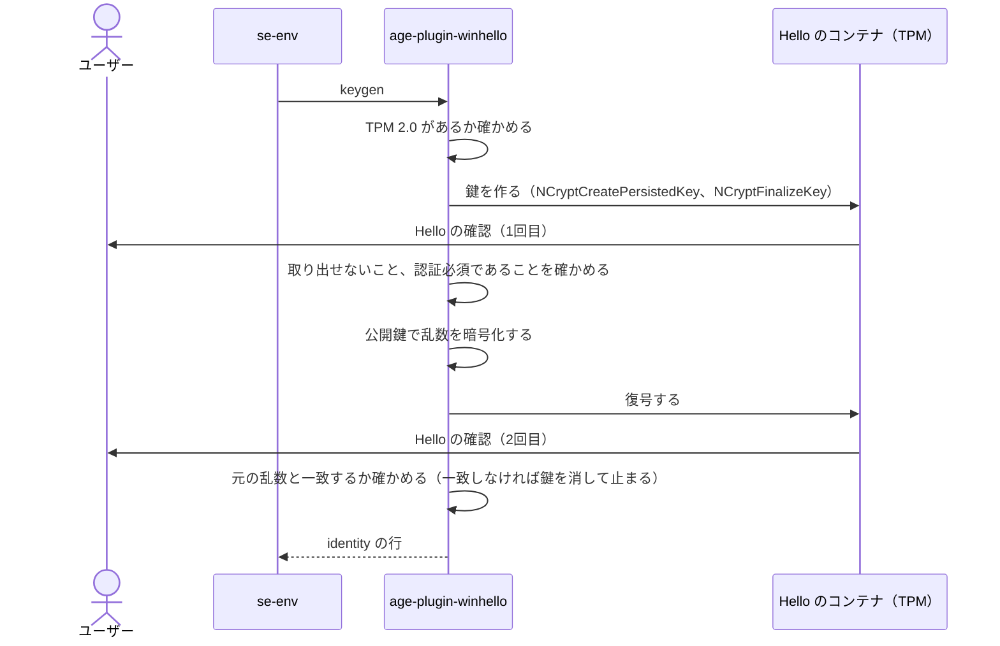
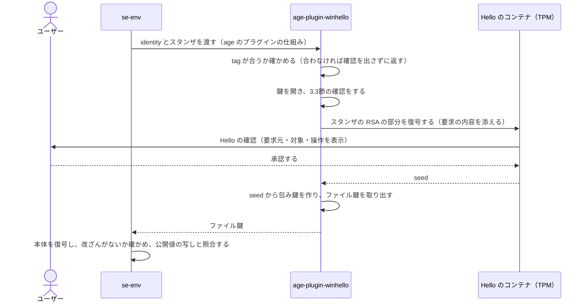

# 設計メモ：Windows Hello による Windows 対応

日本語のみ

> **状態：se-env 0.9.0 で実装済み。** 実機（Windows 11 Build 26300、AMD fTPM）で、鍵の作成、保存、復号、`exec`、セッション、`rekey`、プロセスの保護を確かめました。結果は10章にあります。ビルドの手順は [build_win.ja.md](build_win.ja.md) にあります。macOS 版の仕組みは [encryption.ja.md](encryption.ja.md) を前提にしています。

## 1. 目的と範囲

macOS 版と同じことを、Windows でも実現します。

- 秘密情報を、この PC の外では復号できない形で保存する
- 復号のたびに本人確認（顔・指紋・PIN）を求める
- 平文をディスクに書かず、値は環境変数でだけコマンドに渡す
- セッションの間は、決めた範囲のプロセスにだけ確認なしで値を渡す

加えて Windows では、**同じユーザーの権限で動くほかのプログラム**から、できるだけ守ります。Windows は macOS と違い、同じユーザーのプロセスどうしを標準では隔てないためです（7章）。

範囲外：WSL の中から使うこと、TPM 2.0 のない PC、PowerShell の Tab 補完、macOS と Windows で同じ保管庫を使うこと（11章 D4）。

## 2. 方式の選択

| 方式 | 鍵の処理 | 本人確認 | 判断 |
|---|---|---|---|
| A. TPM の鍵を直接使う（CNG の Platform Crypto Provider） | TPM の中で計算する | TPM の PIN だけ。同じユーザーのプログラムが PIN を知れば黙って使える | 採らない |
| B. Hello の署名から鍵を作る（`KeyCredentialManager`） | 署名から X25519 の鍵を導出する。鍵は毎回同じで、プロセスのメモリに出る | Hello | 最初に実装したが、やめた |
| **C. CNG の Hello 用プロバイダーの鍵で復号する** | Hello のコンテナ（TPM で保護）の中で RSA の復号をする。鍵は外に出ない | Hello。使うたびに必須 | **採用** |
| D. `UserConsentVerifier` | 鍵と結びつかない「はい／いいえ」 | Hello | 使わない。確認を飛ばしても復号できる |

B には、導出した鍵が毎回同じで、プラグインのメモリから一度でも読まれると、それ以後は確認なしに保管庫のすべてを復号できる、という弱点がありました。C では、復号そのものを Hello のコンテナの中で行います。秘密鍵も、そこから作った固定の秘密も、プロセスのメモリには出ません。Secure Enclave と同じ形です。

## 3. 鍵の仕組み

### 3.1 Hello の鍵

CNG の「Microsoft Passport Key Storage Provider」に、RSA 2048 ビットの鍵を作ります（`NCryptCreatePersistedKey`）。鍵の名前は `<ユーザーの SID>//se-env//se-env-<ランダムな16進>` です。

| 設定 | 値 | 意味 |
|---|---|---|
| `Key Usage` | 復号だけ | 署名には使えない |
| `NgcCacheType` | 認証必須（1） | 使うたびに Hello のジェスチャーが必要。Windows が承認を使い回さない |
| `Export Policy` | 0（作成時の既定） | 秘密鍵を取り出せない |
| `Use Context` | 文字列 | Hello のダイアログに出す文（5章） |

- 鍵を開くこと（`NCryptOpenKey`）、公開鍵を読むこと（`NCryptExportKey`）、設定を読むことには、確認が要りません。
- 復号（`NCryptDecrypt`）は、そのたびに Hello の確認が出ます。実機で、続けて2回復号すると2回とも確認が出ることを確かめました。これは鍵の設定（`NgcCacheType` = 1）で強制されます。同じハンドルで続けて復号しても、呼び出し側が `PinCacheIsGestureRequired` に 0 を指定しても、確認は省けませんでした（V14）。
- このプロバイダーが復号できるパディングは PKCS#1 v1.5 だけです（OAEP は `0x80090027` で拒否されました）。
- 鍵が TPM にあるかを示す一般のプロパティ（`Impl Type`）は、このプロバイダーでは読めません（`0x80090029`）。このプロバイダー独自の `NgcKeyImplType` は確認なしに読めます。実機の値は `0x21`（ハードウェア `0x1` と仮想化による隔離 `0x20`）でした。プラグインは、鍵を作る前に PC に TPM 2.0 があること（`Tbsi_GetDeviceInfo`）を確かめ、作った鍵と使う鍵の `NgcKeyImplType` にハードウェアのフラグがなければ拒否します。このプロパティを読めない Windows では、TPM 2.0 があることの確認だけになります。

### 3.2 宛先とスタンザ

RSA でファイル鍵を直接包むことはしません。RSA では乱数の種だけを運び、そこから作った鍵でファイル鍵を認証付きで暗号化します。PKCS#1 v1.5 しか使えないことへの備えです（復号結果が正しいかは、認証付き暗号で確かめます）。

```
pub       = 鍵の公開部分（BCRYPT_RSAPUBLIC_BLOB、283バイト）
宛先       age1winhello1… = bech32(version = 2 ‖ pub)

seed      = ランダムな32バイト
スタンザ    -> winhello <tag>
           本文 = RSA-PKCS1(pub, seed) ‖ ChaCha20-Poly1305(包み鍵, nonce = 0, ファイル鍵)

  tag     = SHA-256(pub) の先頭4バイト（base64）
  包み鍵   = HKDF-SHA-256(seed, salt = SHA-256(pub), info = "se-env/winhello/v2/wrap")
```

- 暗号化に使うのは公開鍵だけなので、**暗号化に本人確認は要りません**。新しいプロファイルへの最初の `set` で確認が出ない、という macOS 版の性質を保てます。
- `tag` があるので、プラグインは自分宛てでないスタンザでは確認を出しません。
- `seed` はファイルごとに違い、復号のたびに Hello のコンテナから受け取ります。漏れても、そのファイル鍵がわかるだけです。

### 3.3 identity と、公開鍵の差し替えへの備え

```
AGE-PLUGIN-WINHELLO-1… = bech32(
    version        1バイト（2）
    key_name       Hello の鍵の名前（例 "se-env-0123456789abcdef"）
    public_sha256  32バイト（公開鍵の SHA-256）
)
```

identity は秘密ではありませんが、なくすと保管庫を復号できません。macOS 版と同じです。

プラグインは、公開鍵を求めるとき（`recipients`）も復号するときも、確認なしに次のことを確かめます。

- identity が示す名前の鍵が、このユーザーの Hello のコンテナにある
- その公開鍵の SHA-256 が identity と一致する
- その鍵が今も「取り出せない」「使うたびに認証必須」で、ソフトウェアの鍵ではない

`identity.txt` を書き換えて、se-env に別の鍵宛てで暗号化させるには、攻撃者は Hello のコンテナに自分の鍵を作る必要があります。それには Hello の確認が出ます。確認なしに使える鍵やソフトウェアの鍵は、上の確認で拒否されます。

## 4. 処理の流れ

### 4.1 鍵の作成（`se-env init`）



確認は2回です。2回目は、鍵が実際に復号できることを、秘密を預ける前に確かめるためです。

### 4.2 暗号化（`set`）

se-env がプラグインの `recipients` に identity を渡し、`age1winhello1…` を受け取ります（3.3節の確認つき）。そのあと age のプラグインの仕組みで、公開鍵宛てにファイル鍵を包みます。本人確認は出ません。

### 4.3 復号（`get`、`exec`、`header` など）



秘密鍵は Hello のコンテナから出ません。プラグインが受け取るのは `seed`、se-env が受け取るのはファイル鍵です。

## 5. 要求の内容を表示する

macOS 版では、パッチを当てた age-plugin-se が Touch ID のダイアログに「要求元」「対象」「操作」を出します。Windows でも同じ文を、**Hello のダイアログそのもの**に出します（`Use Context` プロパティ）。実機で表示を確かめました。

- se-env は macOS 版と同じく、`SE_ENV_AUTH_REASON` に文を入れてプラグインを起動します。
- プラグインがこの文を使うのは、親プロセスがプラグインと同じディレクトリの `se-env.exe` のときだけです（`QueryFullProcessImageNameW` で実際のパスを比べ、親の起動時刻が自分より前であることも確かめます）。それ以外のときは「se-env から起動されていない」という文を出します。
- 「要求元」の並びは、親プロセスを順にたどって作ります。名前は自己申告で、証明ではありません。Windows では親プロセスを偽って起動することもできます。心当たりのない要求に気づくための表示で、要求元を認証するものではありません。
- 同じユーザーのほかのプログラムも、この鍵で復号を求め、好きな文を出せます（V14 で確かめました。偽の「se-env: get work/TOKEN」がそのまま出ました）。ダイアログには、文とは別に、Windows が要求元のアプリ名を出します。se-env からの要求なら `age-plugin-winhello` です。ただし、プログラムの名前は誰でも付けられます。ダイアログの文だけを信用せず、自分が今その操作をしたかどうかで判断してください。

## 6. セッション

### 6.1 Job Object でメンバーを判定する

macOS 版のエージェントは、接続してきたプロセスの親をたどり、セッションのコマンドの子孫かどうかで判定します。Windows ではこの方法をそのまま使えません。親プロセスを偽って起動でき、親が終了しても子の「親 PID」が残って、その PID が使い回されるためです。

そこで **Job Object** を使います。

1. エージェント（`se-env session`）は名前のない Job Object を作り、**自分自身をその Job に入れて**から、セッションのコマンドを起動します。Job の中のプロセスが起動したプロセスは、自動的に同じ Job に入ります。
2. Job には `JOB_OBJECT_LIMIT_BREAKAWAY_OK` も `JOB_OBJECT_LIMIT_SILENT_BREAKAWAY_OK` も付けません。コマンドの子孫は Job から抜けられません。
3. 接続してきた相手の PID を `OpenProcess`（`PROCESS_QUERY_LIMITED_INFORMATION`）で開き、`IsProcessInJob` で確かめます。

PID の使い回しも問題になりません。使い回された PID のプロセスが Job の中にいれば、それはセッションの子孫です。

副作用として、子プロセスの起動に `CREATE_BREAKAWAY_FROM_JOB` を使うプログラムは、セッションの中では起動に失敗します。Git for Windows の `sh`、cmd、PowerShell、Node.js、Claude Code では問題がないことを確かめました（V11）。

逆に、Windows が別に起動するプログラムは Job に入りません。セッションの中から Windows Terminal の新しいウィンドウを開くと、その中のシェルはセッションの外になります。Windows Terminal で使うときは、タブの中で `se-env session` を起動してください。

### 6.2 通信路

macOS 版と同じ **AF_UNIX ソケット**（`run/<id>.sock`）を使います。Windows 10 1803 以降で使え、エージェントと se-env の Go のコードをほぼそのまま共有できます。

- 相手の PID は `SIO_AF_UNIX_GETPEERPID`（`WSAIoctl`）で得ます。
- 相手が同じユーザーかは、相手のプロセスのトークンのユーザー SID で確かめます。
- `run\` は保護された ACL（自分、SYSTEM、Administrators だけ）を持ちます。
- se-env の側も相手を確かめます。待ち受けているプロセスが同じユーザーで、かつ自分の祖先であるときだけ使います。親をたどるときに「親の起動時刻が子より後」なら、PID の使い回しとみなしてそこで止めます。親を偽って起動するには、偽る親のプロセスを開く必要があり、エージェントは7章の保護でそれを許しません。

キャッシュの持ち方、期限（`--ttl`）、`--only`、`lock`、`cache list` と `cache rm`、`vault/<profile>.age` の SHA-256 による照合は、macOS 版と同じコードです。

## 7. 同じユーザーのほかのプログラムから守る

Windows では、同じユーザーのプロセスは、権限を昇格しなくても、ふつうは他のプロセスを開いてメモリを読み、ハンドルを複製し、スレッドを乗っ取れます。se-env（すべてのコマンド）、プラグイン、se-env-ui は、起動した直後に次の保護をかけます（`sewin::process::harden_self`）。プロセスの DACL を設定できなかったときは、se-env は保管庫を使うコマンドを実行せず、プラグインは何もせずに終了し、se-env-ui は値の入力を受け付けません。

| 保護 | 内容 |
|---|---|
| プロセスの DACL | 許すのは、状態の問い合わせ、終了の待機、強制終了だけ。メモリの読み書き、ハンドルの複製、スレッドの作成、親としての利用はできない。`OWNER RIGHTS` のエントリで、所有者が DACL を戻すことも防ぐ |
| スレッドの DACL | 許すのは問い合わせと待機だけ。一時停止や、レジスタの読み書き（コードの実行につながる）はできない。あとから増えたスレッドにも付くよう、se-env はプロセスが動いている間ずっと付け直す。Go のランタイムがスレッドを増やしたことを 50 ミリ秒ごとに確かめ、増えていればすぐに、そうでなくても2秒ごとに付け直す（`exec` でコマンドの終了を待つ間と、エージェントが動いている間を含む） |
| ASLR | イメージ、ヒープ、スタックのアドレスを実行のたびに変える。プログラムは再配置可能な64ビットのイメージとしてビルドし（`DYNAMICBASE`、`HIGHENTROPYVA`）、さらに起動後に、再配置を強制し、再配置できないイメージを拒否する |
| DLL の注入の防止 | AppInit DLL やウィンドウフックなど、古い仕組みでの DLL の読み込みを無効にする。ネットワーク上の DLL を読み込まない。以後は Microsoft の署名がある DLL しか読み込めない |
| 起動時に読み込む DLL | Rust のプログラムと DLL は、インポートする DLL を System32 だけから読み込む（リンク時の `/DEPENDENTLOADFLAG:0x800`）。この指定がないと、`ncrypt.dll`、`bcrypt.dll`、`tbs.dll`、`crypt32.dll` などは、上の保護をかける前に、プログラムと同じディレクトリから先に探される |
| 制御フローの保護 | Rust のプログラムと DLL は Control Flow Guard を有効にしてビルドする。間接呼び出しの行き先は、関数の入口に限られる |
| 動的なコードの禁止 | 実行可能なメモリを新しく作れない |
| キャッシュの暗号化 | セッションのエージェントは、復号したプロファイルを `CryptProtectMemory`（このプロセスだけが使える鍵）で暗号化して持つ。要求に応えるときだけ復号する。暗号化できなかったプロファイルはキャッシュせず、開けなかったキャッシュは「ない」ものとして扱う。要求に応えた直後は、送受信に使ったバッファに平文が残ることがある |
| ダンプ | Windows エラー報告のダンプにヒープを入れない |

昇格していない同じユーザーのプロセスから、エージェントのプロセスと全スレッドへのアクセスが拒否されることを、実機で確かめました（10章 V9）。緩和ポリシーが実際に有効になることは、Rust のテストで確かめています。

これらの保護は、子プロセスには引き継がれません。`exec` や `session` で起動するコマンドは、ふつうのプロセスのままです。

この保護は、se-env が動き出したあとに来たプログラムを止めるものです。次の2つは防げません（10章 V15、V16。12章）。

- **保護をかける前に開かれたハンドル**：DACL は、これから開くときにだけ効きます。se-env を起動したプログラムは、起動したときに得た全権のハンドルを持ち続けます。プロセスの起動を見張っているプログラムも、保護がかかる前に開けます。
- **コンソールのホスト**：端末で動く se-env には、コンソールのホスト（`conhost.exe`。同じユーザーの、保護されていないプロセス）が全権のハンドルを持っています。

## 8. その他の OS 依存部分

| macOS 版 | Windows 版 |
|---|---|
| `exec` は `syscall.Exec` で se-env をコマンドに置き換える | Windows には exec がない。コマンドを子プロセスとして起動して終了を待ち、終了コードを返す。Ctrl+C は同じコンソールのコマンドに届くので、se-env 自身は無視する。値はコマンドが終わるまで se-env のメモリに残るので、7章の保護で守る |
| `osascript` の伏せ字のダイアログ（`set`）と確認のダイアログ | 端末があれば端末で伏せ字の入力を受ける。なければ `se-env-ui.exe` の Win32 のダイアログ |
| 改ざんの警告ダイアログ（終了コード 3） | `se-env-ui.exe alert`。プロファイルごとのロックファイルを自分でロックし、表示している間は持ち続ける。se-env が終了しても残る |
| `umask 077`、所有者の確認 | ACL の確認（所有者が自分、SYSTEM、Administrators、TrustedInstaller のどれかで、ほかの SID に書き込みの権限がない）と、`init` での `vault` への保護された ACL の設定 |
| `flock` | `LockFileEx` |
| 拒否するキー名の一覧 | 大文字と小文字を区別せずに比べる。`PATHEXT`、`COMSPEC`、`PSModulePath`、`SystemRoot`、`windir`、`TEMP`、`TMP`、`HOMEDRIVE`、`HOMEPATH`、`ProgramFiles`、`__COMPAT_LAYER`、`PSExecutionPolicyPreference`、.NET のプロファイラや起動時の設定などを加える |
| `PATH` をプラグインのディレクトリに絞る | 同じ。`exec` と `session` のコマンドも、カレントディレクトリと相対パスの PATH からは探さない。加えて、se-env 自身の環境に `NoDefaultCurrentDirectoryInExePath` を設定し、`GODEBUG` を外す。age のライブラリはプラグインを名前で起動するので、設定しないと、カレントディレクトリに同じ名前のファイル（`age-plugin-winhello.cmd` など）があるだけで復号が始まらず、`GODEBUG=execerrdot=0` のもとではそのファイルが実行される。起動するコマンドには、呼び出し元の環境をそのまま渡す |
| メッセージは「Touch ID」「Secure Enclave」「Mac」 | 名前を置き換えて表示する。ヘルプなど置き換えだけでは足りないものは `locales/windows/` で上書きする |
| 言語は環境変数から。なければ英語 | 環境変数がなければ、ユーザーのロケール |

## 9. `se-env rekey`

鍵を入れ替えて、すべてのプロファイルを暗号化し直します。macOS 版でも使えます（`rekey.go`）。途中で止まってもプロファイルを失わないよう、次の順に進めます。

1. 新しい鍵を作り、`identity.new.txt` に書く（Windows では確認が2回）
2. `identity.txt` を `identity.old.txt` に、`identity.new.txt` を `identity.txt` に名前を変える
3. プロファイルを1つずつ、古い鍵で復号し（プロファイルごとに確認が1回）、同じ平文を新しい鍵で暗号化して置き換える。全プロファイルのロックを持ったまま行う
4. 古い鍵を削除し（Windows では Hello の鍵も）、`identity.old.txt` を消す

`identity.old.txt` がある間は、ふだんの復号でも古い鍵を試します。もう一度 `rekey` を実行すると、3から続けます。すでに新しい鍵になっているプロファイルは、確認を出さずに飛ばします。

方式 C では鍵がメモリに出ないので、方式 B のときのように定期的な入れ替えは要りません。鍵を作り直したいとき（Hello の設定を変えたあとなど）に使います。

## 10. 検証の結果

実機（Windows 11 Build 26300、AMD fTPM、Windows Hello は PIN と生体認証を設定済み）で確かめた結果です。「未確認」のものは、文書の記述が推測に基づいています。

| ID | 確かめたこと | 結果 |
|---|---|---|
| V1 | Hello 用プロバイダーに、復号用の RSA 鍵を作れるか | 確認済み。鍵の名前は `<SID>//se-env//<名前>` の形でないと `0x80090027` で失敗する |
| V2 | 復号のたびに確認が出るか | 確認済み。続けて2回復号して、2回とも出た。セッションの外の `get`、`exec` でも毎回出た |
| V3 | 鍵を取り出せないか、認証必須の設定が残るか | 確認済み（`Export Policy` = 0、`NgcCacheType` = 1。開き直しても同じ） |
| V4 | 開く、公開鍵を読む、設定を読むことに確認が要らないか | 確認済み。SSH の中でも動いた |
| V5 | 鍵が TPM にあることの確かめ方 | 確認済み。`Impl Type` は読めないが、`NgcKeyImplType` は確認なしに読めて、この PC の鍵は `0x21`（ハードウェアのフラグあり）だった。プラグインはこの値を確かめる。TPM による構成証明までは確かめていない |
| V6 | Hello のダイアログに文を出せるか | 確認済み（`Use Context`） |
| V7 | 使えるパディング | PKCS#1 v1.5 だけ。OAEP は不可 |
| V8 | 削除した鍵が開けなくなるか | 確認済み（`0x8009000D`）。`rekey` と `destroy` で使う |
| V9 | 昇格していない同じユーザーのプロセスを防げるか | 確認済み。プロセスへの `VM_READ`、`DUP_HANDLE`、`CREATE_THREAD`、`WRITE_DAC` と、全スレッド（10本）への `GET_CONTEXT`・`SET_CONTEXT`・`SUSPEND_RESUME` が拒否された。保護していない子プロセスでは、どれも通った |
| V10 | 緩和ポリシーが有効になるか | 確認済み（Rust のテスト）。ASLR は4つのフラグを同時に指定する必要があった |
| V11 | セッションの中で使えるツール | 確認済み。Git for Windows の `sh`、cmd、PowerShell は問題なし。Node.js 22 は、`execFileSync`、`exec`、`spawn`（`detached`、`shell` を含む）、孫プロセスのどれから起動した se-env もメンバーと判定された。Claude Code（ネイティブ版 `claude.exe`）は、Bash ツールのコマンドがメンバーと判定され、`exec` は1回目だけ Hello が出て、2回目はキャッシュから値が渡った。Windows Terminal は、セッションの中から新しいウィンドウを開くと、その中のシェルはメンバーにならなかった（Windows が Job の外で起動する。`SE_ENV_SESSION` を渡しても同じ）。タブの中で `se-env session` を起動すれば問題ない |
| V12 | PIN のリセット、TPM のクリアで鍵がどうなるか | 確認済み（Hyper-V の仮想マシン、第2世代・仮想 TPM、Windows 11 26H2 評価版で）。PIN の変更では鍵は残り、復号できた。PIN の削除と再設定では鍵が消えた（`0x8009000D`）。TPM のクリアでは、鍵は開けて設定も読めるが、使うと `0x8007139F` で失敗した（Hello の確認も出ない）。どちらの場合も保管庫は二度と復号できない。se-env は、復号に失敗したときにプラグインに鍵の状態を尋ね（確認なし）、鍵が失われていればそう表示する。仮想 TPM でも `NgcKeyImplType` はハードウェア（`0x1`）だった |
| V13 | SSH やリモートデスクトップの中で使えるか | 確認済み。SSH の中では、確認の要らない操作（`recipients`、`list`、`ls`）は動く。復号の確認はデスクトップにしか出ない。リモートデスクトップ（Mac のアプリから接続）の中では、`init` で鍵を作ろうとすると、確認が出ないまま `0x80090010`（アクセス拒否）で失敗した。作りかけの鍵は残らなかった。リモートデスクトップでは使えないものとする |
| V14 | 同じユーザーの別のプログラムが、この鍵を開いて復号を求められるか | 確認済み。se-env を使わない、昇格していない PowerShell から、`age-plugin-winhello keygen` で作った使い捨ての鍵（本物と同じ設定）を試した。確認なしに鍵を開き、設定と公開鍵を読めた。復号は、承認すれば成功した。同じハンドルで続けて復号しても、`PinCacheIsGestureRequired` に 0 を指定しても、毎回確認が出て、キャンセルすると `0x80090036` で失敗した。顔認証では、2回目の確認がキャンセルする前に自動で承認されたことが2回あった（カメラをふさぐとキャンセルできた）。ダイアログの文は呼び出し側が自由に決められた。要求元のアプリ名は Windows が別に表示した |
| V15 | 保護がかかるまでの時間 | 計測した。エージェントを起動してから 70〜100 ミリ秒の間は、特権のない同じユーザーのプロセスから `VM_READ`、`DUP_HANDLE`、`CREATE_THREAD` で開けた。スレッドは 150〜300 ミリ秒まで開けた。そのあとは拒否された |
| V16 | 保護されたプロセスへのハンドルを、ほかのプロセスが持っているか | 持っている。エージェントに対して、`conhost.exe`（同じユーザー。特権なしで開ける）と `csrss.exe`（SYSTEM）が全権（`0x1FFFFF`）のハンドルを持っていた。SSH の中で確かめた |
| V17 | セッションのコマンドは開けるか | 開ける。セッションで起動したコマンドには、特権のない同じユーザーのプロセスからすべての権限で開けた（保護は子プロセスに引き継がれない） |
| V18 | 起動時の DLL の探索 | 対策の前は、プラグインの隣に `tbs.dll` という名前のファイルを置くと、起動時にそれを読みに行って失敗した（`0xC000012F`）。`/DEPENDENTLOADFLAG:0x800` を付けたあとは、System32 から読み込んで動いた |
| V19 | カレントディレクトリの同じ名前のファイル | 対策の前は、カレントディレクトリに `age-plugin-winhello.cmd` を置くと、プラグインが起動されず復号に失敗した（ファイルは実行されない）。対策のあとは、`GODEBUG=execerrdot=0` を付けても、`bin` のプラグインが起動された |

## 11. 決定事項

| ID | 内容 | 決定 |
|---|---|---|
| D1 | 言語 | 本体は Go のまま。Windows の API を呼ぶ部分は Rust で書く。Go からは、Rust で作った DLL（`se_env_win.dll`）を cgo なしで読み込んで呼ぶ |
| D2 | Hello を呼ぶ場所 | 別のプラグイン（`age-plugin-winhello`）。DLL、プラグイン、ダイアログで使う Rust のコードは、共通のクレートにまとめる |
| D3 | ダイアログ | Rust の別プログラム `se-env-ui.exe` |
| D4 | 複数の宛先 | 扱わない。macOS と Windows は、それぞれの方式で別々に保管する。共通にするのはコマンドラインだけ |
| D5 | `rekey` が途中で失敗したときの回復 | 古い identity を `identity.old.txt` として残し、すべて置き換え終わってから消す |
| D6 | ビルド | `cargo build --locked`。手順は [build_mac.ja.md](build_mac.ja.md) と [build_win.ja.md](build_win.ja.md) に分ける |
| D7 | コマンドの名前 | Windows でも `se-env` |
| D8 | Hello の鍵の名前 | `se-env-<ランダムな16進>`（プロバイダーには `<SID>//se-env//` を前に付けて渡す） |
| D9 | 鍵の方式 | 方式 C（CNG の Hello 用プロバイダーで復号）。方式 B は公開していないので、互換性は持たない |

## 12. 脅威モデルの差分

[encryption.ja.md](encryption.ja.md) 8章から変わるところだけを書きます。

### 守れるもの

- 保存中の秘密情報、他の PC と他のユーザー、セッションの制限、暗号文の改ざん、秘密の送り先、コマンドライン。仕組みは macOS 版と同じです。
- **セッションの外のプロセス**：ほかのユーザーのプロセスと、セッションの外でふつうに起動された se-env には、キャッシュを渡しません。同じユーザーの、悪意のあるプログラムに対しては守れません（下の「セッションへの参加」）。
- **鍵**：秘密鍵は Hello のコンテナから出ず、se-env やプラグインのメモリに出ません。同じユーザーのプログラムが se-env のファイルやメモリをすべて読めたとしても、鍵は手に入りません。
- **黙って使われること**：鍵を使うたびに Hello の確認が出ます。同じユーザーのプログラムでも、確認なしには復号できません。
- **動作中の se-env への割り込み**：se-env が動き出したあとに来た、昇格していない同じユーザーのプログラムは、se-env、エージェント、プラグインを直接開いてメモリを読むこと、スレッドを乗っ取ること、DLL を注入することができません（7章）。攻撃を難しくするための備えで、同じユーザーとの間の境界にはなりません（下の「保護をかける前」と「ほかのプロセスが持つハンドル」）。

### 守れないもの・限界

同じユーザーの権限を取られた場合に、残るものです。

- **承認の誘導**：マルウェアは自分で復号を求め、あなたが Hello を承認するのを待てます。ダイアログの文も自分で決められます（V14）。確認を省くことはできませんでした。心当たりのない確認は承認しないでください。顔認証は、ダイアログが出た瞬間に自動で承認されることがあるので、この点では PIN や指紋のほうが安全です。
- **値を渡したあと**：`exec` で起動したコマンドと、セッションの中のプログラムは、ふつうのプロセスです。同じユーザーのプログラムは、そのメモリや環境変数を読めます。秘密を持つコマンドは短時間で終わるものにし、セッションの範囲と期限は絞ってください。
- **プログラムの差し替え**：`bin` の中のファイルや `identity.txt` は、あなたの権限で書き換えられます。差し替えられた se-env は、次にあなたが承認したときに値を持ち出せます。
- **昇格したプロセス**：管理者として昇格したプログラム（`SeDebugPrivilege`）は、7章の保護を越えられます。
- **保護をかける前**：プロセスが起動してから保護をかけるまで（実測で 0.1 秒ほど。V15）と、新しいスレッドができてから付け直すまで（Go のランタイムのスレッドは 50 ミリ秒以内、それ以外は2秒以内）は、守られていません。プロセスの起動を見張っているプログラムは、この間にハンドルを開けます。開いたハンドルは、保護をかけたあとも使えます。
- **ほかのプロセスが持つハンドル**：se-env を起動したプログラム（シェルなど）と、コンソールのホスト（`conhost.exe`）は、se-env への全権のハンドルを持っています（V16）。どちらも同じユーザーの、保護されていないプロセスです。これらに入り込んだプログラムは、そのハンドルを通して se-env のメモリを読めます。
- **セッションへの参加**：セッションのメンバーは Job Object で判定しますが、セッションの中のコマンドはふつうのプロセスです（V17）。同じユーザーのプログラムは、セッションの中のプロセスに入り込むか、そのプロセスを親に指定して自分のプログラムを起動すれば、メンバーとして扱われ、Hello の確認なしにキャッシュ済みのプロファイルを受け取れます。Windows のセッションは、同じユーザーのマルウェアに対する境界ではありません。対象（`--only`）と期限（`--ttl`）を絞ることが、被害の範囲を決めます。
- **入力の盗み見**：`se-env set` で値を入力するときのキー入力は、同じユーザーのキーロガーから守れません。
- **RSA のパディング**：PKCS#1 v1.5 しか使えません。この方式への既知の攻撃は、復号を何度も試せることが前提で、ここでは1回ごとに Hello の承認が要ります。
- **可用性**：Windows Hello の PIN の**削除**や TPM のクリアで鍵は失われ、保管庫は二度と復号できません（V12）。PIN の**変更**は問題ありません。秘密の値は、元の発行元で作り直せるようにしておいてください。
- **使える場面**：Hello の確認は、PC の前でログオンしているデスクトップにしか出ません。SSH とリモートデスクトップの中からは、鍵の作成も復号もできません（V13）。
- **PIN での代用**：Hello では PIN が常に使えます。macOS 版の `any-biometry-or-passcode` と同じです。PIN は TPM が総当たりを防ぎます。

## 13. 実装の構成

```
cmd/se-env/                 Go（macOS と Windows で共通）
  agent.go session.go vault.go commands.go rekey.go …   共通のロジック
  sys_darwin.go             macOS の部分（Unix の権限、flock、LOCAL_PEERCRED、sysctl、osascript、シグナル）
  sys_windows.go            Windows の部分（下の DLL を呼ぶ。ダイアログは se-env-ui.exe）
  win_windows.go            se_env_win.dll を絶対パスで読み込み、関数を呼ぶ（cgo なし）
  locales/windows/          Windows で文が異なるメッセージ
win/                        Rust（Cargo のワークスペース）
  winhello-core/            identity・宛先・スタンザの形式（Windows に依存しない。どの OS でもテストできる）
  sewin/                    Windows API の呼び出し（ACL、ロック、プロセスの保護、Job、AF_UNIX、CNG、メモリの暗号化、ウィンドウ）
  se-env-win/               se_env_win.dll。sewin の関数を C の ABI で公開する（ABI_VERSION）
  age-plugin-winhello/      age のプラグイン（keygen、recipients、delete、プラグインのプロトコル）
  se-env-ui/                ダイアログのプログラム（secret、confirm、alert）
```

- DLL、プラグイン、ダイアログは、どれも `sewin` を使います。同じ Windows API の呼び出しを2回書くことはありません。
- se-env.exe は DLL を、自分と同じディレクトリから絶対パスで読み込みます。DLL のファイルも、se-env.exe、プラグイン、se-env-ui.exe と同じく、所有者と ACL を確かめてから使います。
- Rust のプログラムは C ランタイムを静的にリンクしています。起動後は Microsoft の署名がある DLL しか読み込めないので、これは必須です。
- テスト：Go のテストは macOS と Windows の両方で通ります。Rust のテストは、形式（どの OS でも）と、プロセスの保護（Windows）を確かめます。

## 14. 残っていること

- `encryption.ja.md` に Windows の章を加えるか、この文書を英語にも訳すかを決める
