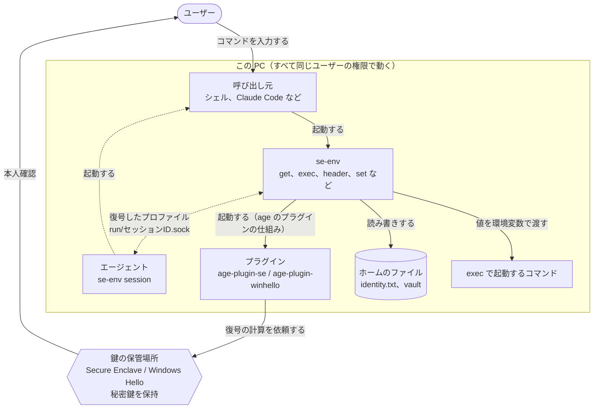
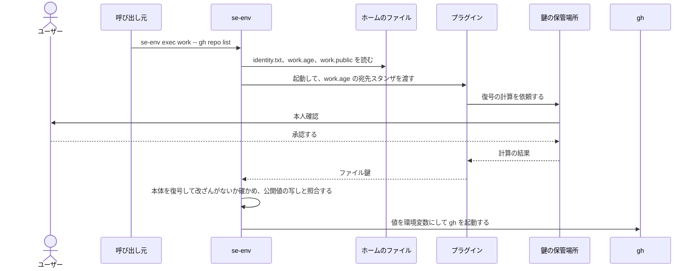
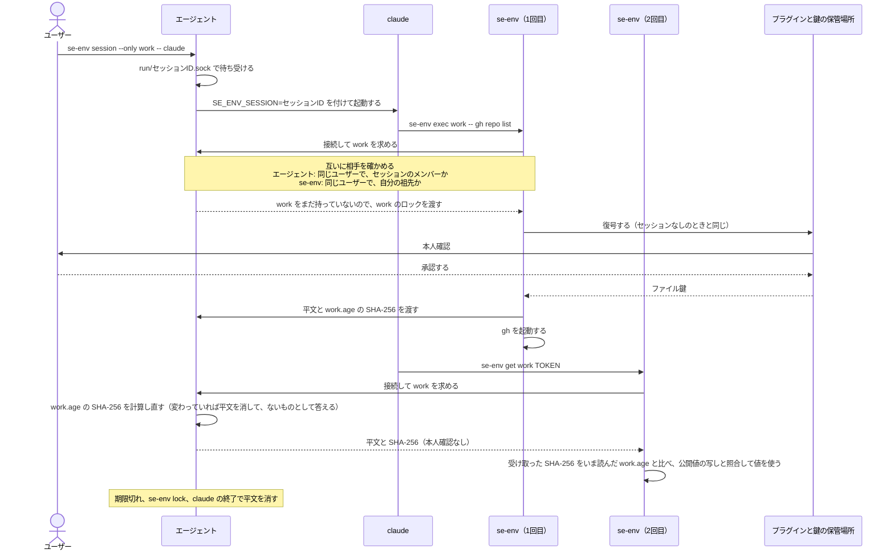
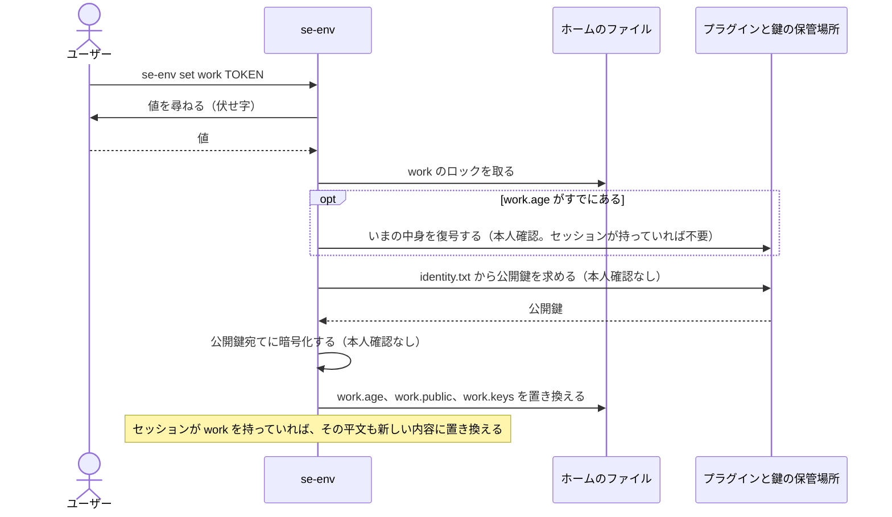

# se-env の仕組み（macOS・Windows 共通）

[English](design.md) | 日本語

この文書では macOS 版と Windows 版に共通する仕組みを説明します。se-env が何を保存し、どう暗号化と復号をし、セッションがどう動き、何を守るかです。鍵の保管場所、本人確認、権限の確かめ方、セッションのメンバーの判定と、OS に固有の限界は、[macOS 版](macos.ja.md)と [Windows 版](windows.ja.md)の文書で説明します。

この文書の「本人確認」は macOS では Touch ID（使えないときはログインパスワード）、Windows では Windows Hello（顔・指紋・PIN）を指します。

se-env は Go のプログラムです。暗号処理はバイナリに組み込んだ [age](https://github.com/FiloSottile/age) のライブラリ（フォーマット v1）と、OS ごとの age のプラグインが行います。

## 1. 構成要素と全体の流れ

| 要素 | 役割 |
|---|---|
| 鍵の保管場所 | 秘密鍵を作って保持します。macOS は Secure Enclave、Windows は TPM で保護された Windows Hello のコンテナです。鍵は外に出ず、使うたびに本人確認を求めます。 |
| プラグイン | 鍵を作り、鍵の保管場所に復号の計算を依頼します。macOS は age-plugin-se、Windows は age-plugin-winhello です。se-env が age のプラグインの仕組みで、別のプロセスとして起動します。 |
| age（ライブラリ） | ファイルを暗号化・復号します。宛先ごとの「スタンザ」を並べたヘッダーと、改ざんを検知できる本体からなります。 |
| se-env | プロファイルを管理し、値をメモリ上で扱い、環境変数でコマンドに渡し、セッションを動かします。 |
| エージェント | `se-env session` のプロセスです。セッションの間、復号したプロファイルをメモリに保持し、セッションの中で動く se-env にだけ渡します（5章）。 |
| 呼び出し元 | se-env を起動するプログラムです。シェルや、Claude Code のようにコマンドを実行するツールがこれに当たります。 |

### 関係図

誰が何を起動し、どこで本人確認を求めるかを示します。点線はセッションを使うときだけの流れです。



- 秘密鍵は鍵の保管場所の外に出ません。プラグインが受け取るのは計算の結果で、se-env が受け取るのは、そこから取り出したファイル鍵です（4章）。
- 本人確認を求めるのは鍵の保管場所です。se-env とエージェントには、確認なしに鍵を使う方法がありません。セッションの中で確認が出ないのは、鍵を使わずに、エージェントのメモリにある平文を渡すためです。

### コマンドを実行するとき（セッションなし）

`se-env exec work -- gh repo list` の例です。`get` と `header` は、最後に値をどう渡すかだけが違います（4章）。



macOS では、se-env は `exec` で gh に置き換わります。Windows では gh を子プロセスとして起動し、終わるのを待ちます。暗号文の形式は3章、復号は4章で説明します。

### セッションの中で使うとき

`se-env session --only work -- claude` で起動した claude が、se-env を2回実行する例です。本人確認を求めるのは1回目だけです。



エージェントがプロファイルを渡す相手の条件と、セッションが終わる条件は5章で説明します。

### 値を保存するとき

`se-env set work TOKEN` の流れです。暗号化には公開鍵しか使わないので、本人確認を求めるのは、すでにあるプロファイルの中身を読むときだけです。



## 2. ファイル

| ファイル | 中身 | 秘密か |
|---|---|---|
| `identity.txt` | プラグインの鍵を表す行をちょうど1つ（macOS は `AGE-PLUGIN-SE-1…`、Windows は `AGE-PLUGIN-WINHELLO-1…`）と、コメント。この行は、鍵を作った PC でしか使えません。 | 他では使えないが**必須**。なくすと保管庫を復号できない |
| `vault/<profile>.age` | age で暗号化したプロファイル | 暗号化済み |
| `vault/<profile>.keys` | そのプロファイルのキー名（1行に1つ）。一覧表示のための目安 | 名前だけ**平文**。値は含まない |
| `vault/<profile>.public` | そのプロファイルの公開値の写し（3章）。表示用。公開値があるときだけ存在する | **平文**。`--public` で保存した値だけが入る |
| `vault/.<profile>.lock` | 空のロックファイル。2つのコマンドが同時に同じプロファイルを書き換えないようにする | いいえ |
| `run/<id>.sock` | 動作中のセッションの AF_UNIX ソケット（5章） | いいえ。秘密はディスクに置かない |

公開鍵は暗号化のたびにプラグインに問い合わせて `identity.txt` から求めます。これに本人確認は要りません。

`identity.txt` に置けるのは、その OS のプラグインの鍵を1行だけです。ソフトウェアの鍵や他のプラグインの鍵は受け付けません。ファイルを差し替えても、気づかれずに本人確認の要求を外すことはできません。

書き込みは同じディレクトリの一時ファイルに書いてから名前を付け替えるので、プロファイルが書きかけの状態になることはありません。se-env は秘密情報を扱う前に、ホーム、`bin`、プログラム、`identity.txt`、`vault`、`run` に自分以外が書き込めないことを確かめ、書き込めれば動作を止めます。確かめ方は OS ごとの文書で説明します（macOS は所有者と権限、Windows は ACL）。

ホームは常に、本体の1つ上のディレクトリ（`<ホーム>/bin/se-env`）です。macOS ではシンボリックリンクを解決してから決めます。環境変数では変えられません。

## 3. プロファイルの暗号化

プロファイルはキーごとに1行の形に直します。

```
API_TOKEN=<base64(値)>
OTHER_KEY=<base64(値)>
```

base64 にするので、値に `=` や改行が含まれていても扱えます。このテキストは age のライブラリがメモリ上で暗号化します。値を平文でディスクに書いたり、他のプロセスから見えるコマンドライン引数に出したりすることは一切ありません。

```
              平文のプロファイル
                     │
age:  ファイル鍵 = ランダムな16バイト
      ├─ ヘッダー ─ 宛先スタンザ（プラグインが作る。形式は OS ごとの文書を参照）:
      │     ファイル鍵を、宛先の公開鍵でしか開けない形に包んだもの
      │     ヘッダーの MAC = HMAC-SHA-256(HKDF(ファイル鍵, "header"), ヘッダー)
      └─ 本体: nonce = ランダムな16バイト
            本体の鍵 = HKDF-SHA-256(ファイル鍵, salt = nonce, info = "payload")
            ChaCha20-Poly1305 のチャンク（64 KiB ごと）を連ねた STREAM
                     │
             vault/<profile>.age
```

宛先は常に、`identity.txt` から求めた公開鍵1つだけです。暗号化に使うのはその**公開鍵**だけなので、本人確認は要りません。新しいプロファイルへの最初の `set` で確認が出ないのはこのためです。

### 公開値

`set --public` は、秘密ではない値を保存します。たとえば、トークンの送り先の URL です。暗号化するテキストの中では、行の先頭に `+` が付きます。

```
API_TOKEN=<base64(値)>
+API_URL=<base64(値)>
```

つまり、値そのものも、それが公開値であることも、秘密と同じ暗号化の中にあります。`get`、`exec`、`header` が使う値は、この暗号化された行からしか取りません。

se-env は公開値の行から `+` を外したものを `vault/<profile>.public` にも書きます。この平文の写しがあるので、`list` と `ls` は本人確認なしで値を表示できます。写しを読むのはこの2つだけで、想定外の内容が混じった写しは表示もしません。

それでも se-env は写しを見張ります。写しが変わっていれば、se-env 以外のものが保管庫に書き込んだことになるからです。

- 書き込む側はプロファイルのロックを持ったまま、暗号文と写しの両方を置き換えます。読む側は同じロックを共有で取って両方を読むので、必ず対になったものを読みます。セッションの中では、エージェントが「どの暗号文から得た内容か」（SHA-256）を応答に添えます。se-env はそれを、いま読んだファイルと比べ、違っていれば問い合わせ直します。
- 復号のたびに、またセッションからの応答のたびに、se-env は写しを、復号したプロファイルの公開値の行とバイト単位で比べます。写しがない場合は、空として扱います。
- 違っていれば、se-env は値を使う前に止まります。標準エラーにプロファイル名と食い違ったキーを出し、警告のダイアログを開き、終了コード 3 で終わります。`exec` に渡したコマンドは起動せず、`get` と `header` は何も出力しません。`set` と `rm` も拒否します。
- ダイアログは別のプロセスで、se-env が終了したあとも画面に残ります。se-env は、標準エラーを表示しないプログラムから実行されることが多いためです。ダイアログは画面に出ている間そのプロファイル用のロックを持つので、失敗が続いてもダイアログは重なりません。
- 元に戻すには `se-env ls --verify <profile>` を使います。セッションは使わず、必ず鍵で復号します。食い違いを1つずつ表示し（写しの内容と、暗号化されたプロファイルの内容）、写しとキー名の索引を作り直します。

### キー名

プロファイルは環境変数としてコマンドに渡すので、キー名は変数名として有効なものに限ります。プログラムの読み込み方や起動のしかたを変える名前は使えません。`PATH`、`HOME`、`SHELL`、`IFS`、`ENV`、`BASH_ENV`、`ZDOTDIR`、`NODE_OPTIONS`、`PYTHONPATH`、`PYTHONSTARTUP`、`PERL5OPT`、`RUBYOPT`、`GIT_SSH_COMMAND`、`AGEDEBUG` と、`DYLD_`・`LD_`・`SE_ENV_` で始まる名前です。Windows ではさらにいくつかの名前を拒否します（[Windows 版](windows.ja.md)の9章）。プロファイルを読むときにも同じ検査をします。こうした名前、形式の崩れた名前、重複した名前、NUL バイトを含む値が入っているプロファイルは、どのコマンドにも渡しません。問題のキーは `se-env rm <profile> <KEY>` で削除できます。この一覧は安全網として設けたもので、危険な変数をすべて挙げたものではありません。

## 4. プロファイルの復号

```
se-env（age ライブラリ）── identity.txt で vault/<profile>.age を復号
             │  宛先スタンザを読み、プラグインを起動する
             ▼
           プラグイン ──► 鍵の保管場所
                           • 本人確認を求める
                           • 秘密鍵で復号の計算をする
             ◄── 計算の結果 ── ファイル鍵を取り出す
           age: ヘッダーの MAC を検証し、本体を復号しながら改ざんがないか確かめる
             │
se-env ◄── 平文（メモリ上） ── KEY と値の組に分解する
```

se-env は復号した結果を次のように使います。

| コマンド | 復号したプロファイルの使い方 |
|---|---|
| `get` | 値を1つ表示する |
| `exec` | 全キーを環境変数に加えてコマンドを起動する |
| `header` | `{"<名前>":"<前置き><値>"}` を出力する（JSON として出力） |
| 既存のプロファイルへの `set` / `rm` | 組を変更して暗号化し直す（3章） |
| `ls --verify` | プロファイルに実際に入っているキー名と公開値を表示し、キー名の索引と公開値の写しを作り直す。必ず鍵を使う |

`list`、`ls`、`profiles` と Tab 補完は、ファイル名と `.keys` の索引、`.public` の写ししか読みません。復号しないので、確認も出ません。索引も写しもそれ自体では改ざんを検知できないので、表示にしか使いません。キー名でない行が1つでもあれば、索引全体を使いません。形式の崩れた写しは表示しません。

プラグインは `PATH` から名前で起動されます。そこで se-env は自分の `PATH` をプラグインのあるディレクトリ1つだけに絞ります（`<ホーム>/bin` を優先し、なければ `PATH` の絶対パスのディレクトリ）。`exec` と `session` で起動するコマンドには元の `PATH` を戻して渡します。また、se-env は自分の環境から `AGEDEBUG` を消します。`AGEDEBUG=plugin` があると、age のライブラリがプラグインとの通信を、ファイル鍵も含めて標準エラーに出すためです。

### 本人確認のダイアログの文

se-env はプラグインを起動する間だけ、環境変数 `SE_ENV_AUTH_REASON` に「要求元・対象・操作」の文を入れます。プラグインはその文を本人確認のダイアログに出します。実際の表示は OS ごとの文書にあります。

- 「要求元」は se-env を起動したプロセスを外側から順に並べたものです。最大 8 個まで出します。
- プラグインがこの文を使うのは、親プロセスがプラグインと同じディレクトリにある se-env のときだけです。実行ファイルの実際のパスで比べます。
- se-env は起動したときと使い終わったときに、この変数を自分の環境から消します。`exec` や `session` で起動するコマンドには渡しません。
- 表示する名前は自己申告で、証明ではありません。同じユーザーで動くプログラムは、自分の名前を選んで起動できます。このダイアログは心当たりのない要求に気づくためのもので、要求元を認証するものではありません。

## 5. セッション

`se-env session [--only p1,p2] [--ttl 30m] -- <コマンド>` を使うと、選んだプロファイルは最初の1回のあと本人確認を省けます。

`se-env session` のプロセスは、`<コマンド>` が動いている間ずっと残り、ssh-agent と同じように**エージェント**として働きます。

1. 復号したプロファイルは**エージェントのメモリにだけ**置きます。ディスクには何も書きません。`SE_ENV_SESSION` に入っているのはセッション ID（ランダムな8バイト）だけで、se-env がどのソケットを使うかを示します。秘密ではありません。
2. エージェントは AF_UNIX のソケット `run/<id>.sock` で待ち受けます。`run` は自分だけが使える権限にします。エージェントは接続のたびに、接続してきたプロセスを OS に尋ね、次の条件をすべて満たすときだけプロファイルを渡したり受け取ったりします。
   - 同じユーザーで動いている
   - セッションのメンバーである。つまり、`<コマンド>` 自身か、そこから起動されたプロセスである。判定のしかたは OS ごとの文書で説明します（macOS は親子関係、Windows は Job Object）

   したがって、別のプロセスが `SE_ENV_SESSION` を設定しても何も得られません。

   se-env の側も相手を確かめます。ソケットからプロファイルを読んだり、ソケットへ渡したりするのは、そこで待ち受けているプロセスが同じユーザーで、かつ se-env 自身の祖先であるときだけです。自分のセッションのエージェントは必ず祖先に当たります。別のプログラムが `run` に置いた偽のソケットは信用しません。
3. 許可したプロファイルを最初に復号するとき、se-env は次の処理をします。
   - エージェントに問い合わせます。まだ何も持っていないので、エージェントは呼び出し元にプロファイルごとのロックを渡します。他の呼び出しは待つので、複数のコマンドが同時に起動しても本人確認は1回で済みます。ロックは接続に結び付いていて、呼び出し元がどんな理由で終了しても解放されます。
   - 鍵で復号します（4章）。ここで確認が出ます。
   - 平文と、復号した `vault/<profile>.age` の SHA-256 をエージェントに渡します。
4. 2回目以降はメモリから応答します。そのたびにエージェントは今の `vault/<profile>.age` のハッシュを計算します。ファイルが変わっていれば、エージェントはその内容を消去し、se-env が鍵で復号し直します。se-env 経由の `set` はすでにある内容を更新します。このセッションで復号していないプロファイルを新しく加えることはありません。
5. 期限と対象はエージェントが持ち、セッションの開始後は変えられません。
   - `--ttl`（既定は30分、最長24時間）は実際の時刻で数えます。PC がスリープしている時間も含みます。期限が過ぎると、エージェントはメモリを消去し、ソケットを削除します。
   - `--only` は、要求のたびにエージェントが確かめます。それ以外のプロファイルは毎回本人確認を求めます。
6. キャッシュは次のときにも終わります。
   - `<コマンド>` が終了した（エージェントはメモリを消去して終了する）
   - `se-env lock` を実行した（キャッシュを捨てる。セッションは続く）
   - `se-env cache rm` を実行した（本人確認のあとでセッションを終える。コマンドは動き続け、以後は毎回本人確認を求める）
   - エージェントが強制終了された（メモリごと消える。残ったソケットは、se-env が次に見つけたときに削除する）

`se-env cache list` はセッションの外からも使えます。同じユーザーのプロセスなら、エージェントに情報（ID、コマンド、開始、期限、対象、キャッシュ済みのプロファイル名）を尋ねたり、キャッシュを捨てるよう伝えたりできます。どちらも値は明かしません。キャッシュを捨てても、se-env が再び本人確認を求めるようになるだけです。

## 6. 削除での本人確認

削除は確認ダイアログだけにもセッションにも頼りません。次のどれも鍵を使うので、セッションの中でも本人確認が出ます。

| コマンド | 確認の内容 |
|---|---|
| `rm <profile> <KEY>…` | 鍵でプロファイルを復号する（セッションのキャッシュは使わない） |
| `rm --all`、`rm-profile --force` | `y/N`（またはダイアログ）で尋ねてから、下の本人確認をする |
| `rm-profile` | 尋ねてから、鍵でプロファイルを復号し、本当に空であることを確かめる（索引は目安にすぎない） |
| `cache rm` | 下の本人確認をする |
| `destroy` | `y/N`、確認用の文字列の入力、10秒の待機のあと、下の本人確認をする |

本人確認ではランダムな24バイトを `identity.txt` から求めた公開鍵宛てに暗号化し、鍵で復号して一致を確かめます。これで必ず確認が出ます。

さらに `destroy` は、端末がない場合とセッションの中では実行を拒否します。また、何かを消す前に、動作中のセッションをすべて終わらせます。

これらの確認は、se-env 自体が無人で秘密情報の削除に使われること（たとえば、あなたの代わりにコマンドを実行するツールによるもの）を防ぎます。ファイルを直接消すプログラムへの防壁ではありません。あなたの権限で動くものなら、それはできてしまいます。

## 7. 脅威モデル（共通）

OS に固有の点は [macOS 版](macos.ja.md)の10章と [Windows 版](windows.ja.md)の13章にあります。

### 守れるもの

- 保存中の秘密情報：平文をディスクに書きません。セッションも同じです。保管庫やそのバックアップ・コピー（バックアップ、ディスクイメージ、盗まれたディスク）は、その PC の鍵の保管場所とあなたの本人確認がなければ復号できません。
- 他の PC と他のユーザー：鍵はその PC に縛られ、ホームのファイルは自分だけが書き込めます。そうなっていなければ se-env は動作を止めます。
- セッション外での無断の利用：あなたの権限で動くプロセスが se-env を起動することはできますが、復号のたびに OS の確認画面が出るので、拒否できます。
- セッションの外にいるプロセス：セッションのキャッシュはエージェントのメモリにあり、セッションのメンバーにしか渡しません。環境変数に鍵はなく、キャッシュのファイルもないので、他のプロセスの環境変数や `run` のファイルを読んでも何も得られません。
- セッションの制限：期限と `--only` はエージェントの中にあります。セッション内のプロセスが延長したり対象を広げたりすることはできません。
- 暗号文の改ざん：age はヘッダーと本体の改ざんを検知します。書き換えられたファイルは復号に失敗します。
- 公開鍵の差し替え：プロファイルの宛先は `identity.txt` から求めた鍵だけです。ファイルを足して宛先を増やすことはできません。
- 秘密の送り先：URL のような公開値は暗号化されたプロファイルからだけコマンドに渡り、平文の写しからは渡りません。写しを書き換えても、トークンの送り先は変えられません。書き換えは次の復号で見つかり、se-env は何も実行せずに知らせ、終了コード 3 で終わります（3章）。
- コマンドライン：値をコマンドの引数に入れることはありません。値はメモリ上で扱い、コマンドには環境変数でだけ渡します。

### 守れないもの・限界

- セッションの中：セッションのメンバーはどれも確認なしにキャッシュ済みのプロファイルを読め、`set` で書き換えることもできます。セッションはそのためのものです。そこで起動したツールやエージェント、それらが実行するものも含みます。`--only` は作業に必要なプロファイルだけにし、期限は短くし、終わったら `se-env lock` か `cache rm` を実行してください。
- セッションに入り込む：あなたの権限で動くプログラムは、セッションに属していると名乗るだけでは通りません。しかし、セッション内のプログラムに自分を起動させること（たとえば、そのプログラムが実行するスクリプトや設定ファイルを書き換える）や、セッション内のプロセスに入り込むことは試せます。セッションはキャッシュを読める相手を絞るもので、サンドボックスではありません。
- 値を渡したあと：値をコマンドに渡すと、そのコマンドとそこから起動されたものは、値を読んだり、記録したり、外部へ送ったりできます。
- 動作中のコマンドの環境変数：`exec` がコマンドの環境変数に入れた値は、そのコマンドが動いている間、あなたの権限で動くものなら確認なしに読めます。セッションを使っても変わりません。セッションが環境変数から外しているのはセッションのキャッシュで、`exec` がコマンドに渡す値ではありません。秘密を持つコマンドはできるだけ短時間で終わるものにしてください。`header` は、値を標準出力で渡します。
- 別の場所で export している秘密：シェルの起動ファイルで export したままの秘密や、親プロセスで設定された秘密は、se-env では守れません。そうした値は起動するすべてのプログラムの環境変数に入ります。秘密を se-env に移したら、古い設定を削除し、秘密を再発行し、ターミナルと長時間動いているプログラムを起動し直してください。起動ファイルを直しても、動作中のプロセスは起動したときの環境変数を持ち続けます。
- あなたの権限で動くマルウェアは、自分が起こした確認画面をあなたが承認するのを待ったり、承認するよう誘導したりできます。se-env の本体、プラグイン、`identity.txt`（どれもあなたの所有物）を差し替えることも、保管庫を消すこともできます。確認画面は足止めにはなりますが、隔離の境界ではありません。
- 送り手の認証はありません。age は、ファイルが書き換えられていないことは保証しますが、誰が作ったかは保証しません。`vault` に書き込める人は、あなたの公開鍵宛てに暗号化した別の内容にプロファイルを差し替えられます。se-env は、拒否するキー名（3章）を除いて、それを受け入れます。ホームのディレクトリはあなただけが書き込める状態にしておいてください。
- 差し替えられたプロファイルは、独自の公開値と、それに合った写しを持てます。3章の照合ではあなたが書いたプロファイルと見分けられません。ただし、あなたの秘密は入れられないので、最初に現れる兆候は、キーがなくなっていることや、コマンドが認証に失敗することです。そのときは、秘密を登録し直す前に `se-env ls --verify <profile>` を実行して、公開値を読んでください。確かめずに登録し直すと、新しい秘密が、差し替えられたプロファイルの URL と一緒に使われます。
- 公開値は平文でディスクにあります（`.public`）。あなたのファイルを読めるものなら読めます。`list` と `ls` が表示する値はこの写しから読んだもので、次に復号するまで照合されていません。
- キー名は平文（`.keys`）なので、確認なしに一覧できます。
- メモリ：Go では、値のコピーがすべて消えることまでは保証できません。se-env はセッションのキャッシュを捨てるときに上書きしますが、解放済みのメモリには、プロセスが終わるまで値が残ることがあります。
- 可用性：鍵を失うと、保管庫は二度と復号できません。復旧用の鍵はなく、これは意図した仕様です。鍵を失う操作は OS ごとの文書にあります。秘密情報を再発行できる状態にしておいてください。
