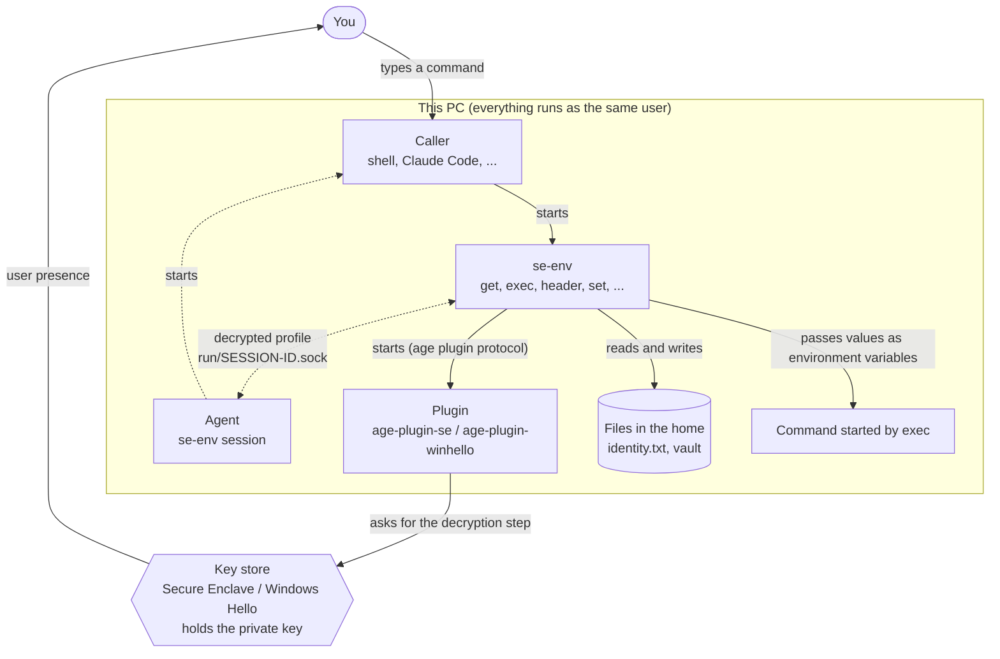
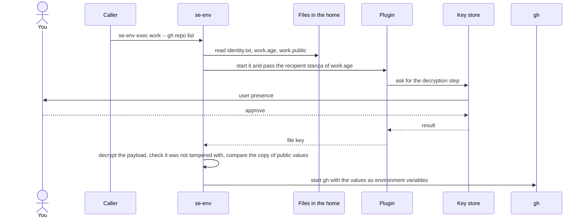
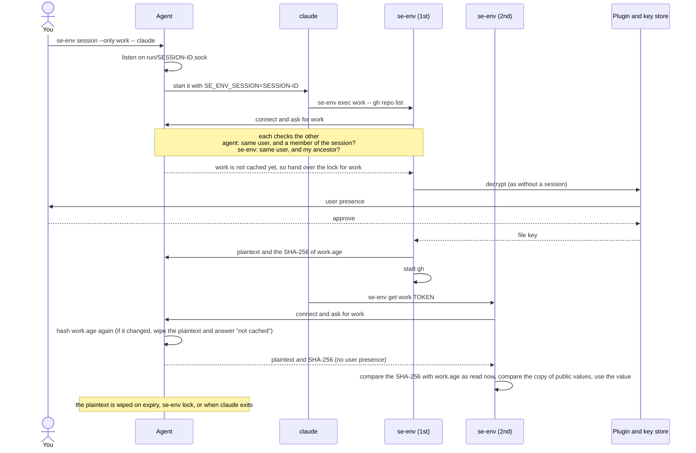
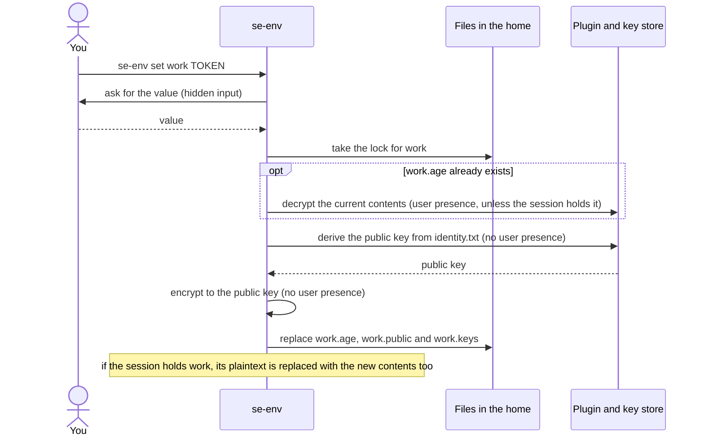

# How se-env works (macOS and Windows)

English | [日本語](design.ja.md)

This document describes what macOS and Windows have in common: what se-env stores, how it encrypts and decrypts, how sessions work, and what is protected. Where the key lives, how you are asked, how permissions are checked, how session members are recognised, and the limits specific to each OS are described in the [macOS](macos.md) and [Windows](windows.md) documents.

"User presence" in this document means Touch ID (or your login password) on macOS, and Windows Hello (face, fingerprint or PIN) on Windows.

se-env is a Go program. Cryptography is done by the [age](https://github.com/FiloSottile/age) library (format v1), linked into the binary, and by an age plugin for each OS.

## 1. Components and how they work together

| Piece | Role |
|---|---|
| Key store | Generates and holds the private key: the Secure Enclave on macOS, the TPM-backed Windows Hello container on Windows. The key never leaves it, and every use asks for user presence. |
| Plugin | Creates the key and asks the key store to do the decryption step: age-plugin-se on macOS, age-plugin-winhello on Windows. se-env runs it as a separate process through age's plugin protocol. |
| age (library) | Encrypts and decrypts files: a header with one stanza per recipient, plus an authenticated payload. |
| se-env | Manages profiles, keeps values in memory, hands them to commands through environment variables, and runs sessions. |
| Agent | The `se-env session` process. For the life of a session it keeps decrypted profiles in memory and hands them only to se-env processes running inside the session (§5). |
| Caller | The program that starts se-env: a shell, or a tool that runs commands for you such as Claude Code. |

### Overview

Who starts what, and where user presence is asked for. Dotted lines are used only with a session.



- The private key never leaves the key store. The plugin receives the result of the computation, and se-env receives the file key derived from it (§4).
- The key store asks for user presence. Neither se-env nor the agent has a way to use the key without it. Inside a session there is no prompt because the key is not used: the agent hands over plaintext it already holds in memory.

### Running a command (no session)

`se-env exec work -- gh repo list`. `get` and `header` differ only in how the value is handed over at the end (§4).



On macOS, se-env replaces itself with gh (`exec`). On Windows it starts gh as a child process and waits for it. The ciphertext format is in §3 and decryption in §4.

### Inside a session

claude, started with `se-env session --only work -- claude`, runs se-env twice. User presence is asked for only the first time.



§5 describes whom the agent hands profiles to and when a session ends.

### Saving a value

`se-env set work TOKEN`. Encryption needs only the public key, so user presence is asked for only to read an existing profile.



## 2. Files

| File | Contents | Secret? |
|---|---|---|
| `identity.txt` | Exactly one line for the plugin's key (`AGE-PLUGIN-SE-1…` on macOS, `AGE-PLUGIN-WINHELLO-1…` on Windows), plus comments. The line can be used only on the PC that created the key. | Not usable elsewhere, but **required**: without it the vault cannot be decrypted. |
| `vault/<profile>.age` | The age-encrypted profile | Encrypted |
| `vault/<profile>.keys` | The profile's key names, one per line. A hint for listing | Names only, **plaintext**. No values |
| `vault/<profile>.public` | Copy of the profile's public values (§3), for display. Present only when the profile has public values | **Plaintext**. Only values saved with `--public` |
| `vault/.<profile>.lock` | Empty lock file, so two commands never rewrite the same profile at once | No |
| `run/<id>.sock` | AF_UNIX socket of a running session (§5) | No. Nothing secret is written to disk |

The public key is derived from `identity.txt` every time se-env encrypts, by asking the plugin. This needs no user presence.

`identity.txt` must hold exactly one key of the OS's plugin. Software keys and keys of other plugins are refused, so replacing the file cannot silently remove the user presence requirement.

Files are written to a temporary file in the same directory and renamed, so a profile is never half-written. Before handling a secret, se-env checks that nobody else can write to the home, `bin`, the programs, `identity.txt`, `vault` and `run`, and stops if someone can. How this is checked differs by OS (owner and mode bits on macOS, ACLs on Windows).

The home is always the directory above the program (`<home>/bin/se-env`); on macOS symlinks are resolved first. It cannot be changed through the environment.

## 3. Encrypting a profile

A profile is serialised one line per key:

```
API_TOKEN=<base64(value)>
OTHER_KEY=<base64(value)>
```

base64 lets values contain `=` and newlines. The text is encrypted in memory by the age library. Values are never written to disk in plaintext, and never appear in command-line arguments, which other processes can see.

```
              plaintext profile
                     │
age:  file key = 16 random bytes
      ├─ header ─ recipient stanza (written by the plugin; see the OS document for its format):
      │     the file key, wrapped so that only the recipient's key can open it
      │     header MAC = HMAC-SHA-256(HKDF(file key, "header"), header)
      └─ payload: nonce = 16 random bytes
            payload key = HKDF-SHA-256(file key, salt = nonce, info = "payload")
            STREAM of ChaCha20-Poly1305 chunks (64 KiB each)
                     │
             vault/<profile>.age
```

The only recipient is always the public key derived from `identity.txt`. Encryption uses only that **public key**, so it needs no user presence. That is why the first `set` into a new profile shows no prompt.

### Public values

`set --public` stores a value that is not secret, such as the URL a token is sent to. In the encrypted text its line starts with `+`:

```
API_TOKEN=<base64(value)>
+API_URL=<base64(value)>
```

So the value, and the fact that it is public, are covered by the same encryption as the secrets. `get`, `exec` and `header` take values only from these encrypted lines.

se-env also writes the public lines, without the `+`, to `vault/<profile>.public`. This plaintext copy lets `list` and `ls` show the values without user presence. Only those two read it, and a copy with anything unexpected in it is not shown at all.

se-env still watches the copy: if it changed, something other than se-env wrote to the vault.

- A writer replaces the ciphertext and the copy while holding the profile's lock. A reader takes the same lock shared and reads both, so it always reads a matching pair. Inside a session, the agent says which ciphertext its answer came from (SHA-256); se-env compares that with the file it just read and asks again if they differ.
- On every decryption, and every answer from a session, se-env compares the copy byte for byte with the public lines of the decrypted profile. A missing copy counts as empty.
- If they differ, se-env stops before using any value. It prints the profile and the keys that differ to stderr, opens an alert dialog, and exits with status 3. The command given to `exec` is not started, and `get` and `header` print nothing. `set` and `rm` are refused too.
- The dialog is a separate process and stays on screen after se-env exits, because se-env is often run by programs that do not show stderr. While on screen it holds a lock for the profile, so repeated failures do not stack dialogs.
- To repair, run `se-env ls --verify <profile>`. It never uses a session and always decrypts with the key. It shows each difference (what the copy said and what the encrypted profile says) and rewrites the copy and the key-name index.

### Key names

A profile is handed to commands as environment variables, so key names must be valid variable names. Names that change how programs are loaded or started are refused: `PATH`, `HOME`, `SHELL`, `IFS`, `ENV`, `BASH_ENV`, `ZDOTDIR`, `NODE_OPTIONS`, `PYTHONPATH`, `PYTHONSTARTUP`, `PERL5OPT`, `RUBYOPT`, `GIT_SSH_COMMAND`, `AGEDEBUG`, and names starting with `DYLD_`, `LD_` or `SE_ENV_`. Windows refuses some more (§9 of the [Windows](windows.md) document). The same check runs when a profile is read: a profile with such a name, a malformed or duplicate name, or a value containing a NUL byte is not handed to any command. Remove the key with `se-env rm <profile> <KEY>`. The list is a safety net, not a complete catalogue of dangerous variables.

## 4. Decrypting a profile

```
se-env (age library) ── decrypt vault/<profile>.age with identity.txt
             │  read the recipient stanza and start the plugin
             ▼
           plugin ──► key store
                        • asks for user presence
                        • does the decryption step with the private key
             ◄── result ── recover the file key
           age: verify the header MAC, decrypt the payload and check it was not tampered with
             │
se-env ◄── plaintext (in memory) ── split into KEY / value pairs
```

se-env uses the decrypted profile as follows:

| Command | What happens with the decrypted profile |
|---|---|
| `get` | prints one value |
| `exec` | starts the command with every key added to its environment |
| `header` | prints `{"<name>":"<prefix><value>"}` (as JSON) |
| `set` / `rm` on an existing profile | changes the pairs and encrypts again (§3) |
| `ls --verify` | shows the key names and public values actually in the profile, and rewrites the key-name index and the copy of public values. Always uses the key |

`list`, `ls`, `profiles` and Tab completion read only file names, the `.keys` index and the `.public` copy. They decrypt nothing, so they never prompt. Neither the index nor the copy can detect tampering by itself, so both are used only for display: one line that is not a key name makes se-env ignore the whole index, and a malformed copy is not shown.

The plugin is started by name through `PATH`, so se-env narrows its own `PATH` to the single directory that holds the plugin (`<home>/bin` first, otherwise an absolute directory of your `PATH`). Commands started by `exec` and `session` get the original `PATH` back. se-env also removes `AGEDEBUG` from its own environment: `AGEDEBUG=plugin` makes the age library copy the plugin protocol, file key included, to stderr.

### The text of the presence dialog

While it runs the plugin, se-env puts "who asks, for what, to do what" into the environment variable `SE_ENV_AUTH_REASON`, and the plugin shows that text in the presence dialog. The OS documents show what it looks like.

- "Who asks" lists the processes that led to se-env, outermost first, at most 8.
- The plugin uses the text only when its parent process is the se-env in the plugin's own directory, compared by the real path of the executable.
- se-env removes the variable from its own environment when it starts and after use, and never passes it to commands started by `exec` or `session`.
- The names are self-reported, not proof: a program running as you can choose its own name. The dialog helps you notice a request you did not expect; it does not authenticate the requester.

## 5. Sessions

`se-env session [--only p1,p2] [--ttl 30m] -- <command>` lets the chosen profiles skip user presence after the first time.

The `se-env session` process stays alive while `<command>` runs and acts as an **agent**, like ssh-agent:

1. Decrypted profiles are kept **only in the agent's memory**. Nothing is written to disk. `SE_ENV_SESSION` holds only the session ID (8 random bytes), which tells se-env which socket to use. It is not a secret.
2. The agent listens on the AF_UNIX socket `run/<id>.sock`; `run` is accessible to you only. On every connection the agent asks the OS which process connected, and hands profiles to it or takes them from it only if all of these hold:
   - it runs as the same user
   - it is a member of the session: `<command>` itself or a process started from it. How membership is decided differs by OS (the parent chain on macOS, a job object on Windows); see the OS documents

   So another process gains nothing by setting `SE_ENV_SESSION`.

   se-env checks the other side too: it reads a profile from, or hands one to, a socket only if the process listening on it runs as the same user and is an ancestor of se-env. The agent of se-env's own session always is. A look-alike socket that another program puts in `run` is never trusted.
3. The first time an allowed profile is needed, se-env:
   - asks the agent. Nothing is cached yet, so the agent hands the caller a per-profile lock. Other callers wait, so several commands started at once ask for user presence only once. The lock belongs to the connection and is released however the caller exits.
   - decrypts with the key (§4). This is where you are asked.
   - hands the agent the plaintext and the SHA-256 of the `vault/<profile>.age` it decrypted.
4. Later requests are answered from memory. Each time, the agent hashes the current `vault/<profile>.age`. If the file changed, the agent wipes its copy and se-env decrypts again with the key. `set` through se-env updates what is already cached; it never adds a profile this session has not decrypted.
5. The TTL and scope live in the agent and cannot be changed once the session has started.
   - `--ttl` (default 30 minutes, at most 24 hours) counts real time, including time the PC is asleep. When it expires, the agent wipes its memory and removes the socket.
   - `--only` is checked by the agent on every request. Other profiles ask for user presence every time.
6. The cache also ends when:
   - `<command>` exits (the agent wipes its memory and exits)
   - you run `se-env lock` (the cache is dropped; the session continues)
   - you run `se-env cache rm` (ends the session after user presence; the command keeps running and every decryption asks again)
   - the agent is killed (its memory goes with it; se-env removes the stale socket when it next finds it)

`se-env cache list` works outside a session too. Any process of the same user can ask an agent for its metadata (ID, command, start, expiry, scope, cached profile names) or tell it to drop its cache. Neither reveals a value, and dropping the cache only makes se-env ask for user presence again.

## 6. Presence checks for deleting

Deleting never relies on a confirmation dialog alone, nor on a session. Each of these uses the key, so you are asked even inside a session:

| Command | What is checked |
|---|---|
| `rm <profile> <KEY>…` | decrypts the profile with the key (never from a session cache) |
| `rm --all`, `rm-profile --force` | asks `y/N` (or a dialog), then the presence check below |
| `rm-profile` | asks, then decrypts the profile with the key to make sure it really is empty (the index is only a hint) |
| `cache rm` | the presence check below |
| `destroy` | `y/N`, typing a phrase, a 10-second wait, then the presence check below |

The presence check encrypts 24 random bytes to the public key from `identity.txt` and decrypts them with the key, so it always prompts.

`destroy` also refuses to run without a terminal or inside a session, and ends every running session before deleting anything.

These checks stop se-env itself from being used to delete secrets unattended, for example by a tool that runs commands for you. They are not a barrier against a program that deletes the files directly; anything running as you can do that.

## 7. Threat model (both OSes)

What is specific to each OS is in §10 of the [macOS](macos.md) document and §13 of the [Windows](windows.md) document.

### Protected

- Secrets at rest: no plaintext is written to disk, sessions included. The vault and any copy of it (backups, disk images, a stolen disk) cannot be decrypted without the key store of that PC and your user presence.
- Other PCs and other users: the key is bound to the PC, and only you can write to the files in the home; se-env stops otherwise.
- Unattended use outside a session: a process running as you can start se-env, but every decryption shows an OS prompt that you can refuse.
- Processes outside a session: the session cache is in the agent's memory and is handed only to members of the session. There is no key in the environment and no cache file, so reading other processes' environments or the files in `run` yields nothing.
- Session limits: the TTL and `--only` live in the agent. A process in the session cannot extend or widen them.
- Tampering with ciphertext: age detects changes to the header and the payload; a modified file fails to decrypt.
- Swapping the public key: a profile's only recipient is the key derived from `identity.txt`. Adding files cannot add recipients.
- Where a secret is sent: public values such as URLs reach commands only from the encrypted profile, never from the plaintext copy, so editing the copy cannot redirect a token. The edit is found at the next decryption, and se-env reports it, runs nothing, and exits with status 3 (§3).
- The command line: values never go into command arguments. They are kept in memory and handed to commands only through the environment.

### Not protected, or limits

- Inside a session: every member of the session can read the cached profiles without asking, and can change them with `set`. That is what a session is for, and it includes the tools and agents you start there and anything they run. Keep `--only` to the profiles you need, keep the TTL short, and run `se-env lock` or `cache rm` when you are done.
- Getting into a session: a program running as you cannot get in by claiming to belong. It can, however, try to get a program inside the session to start it (for example by changing a script or configuration file that program runs), or get into a process of the session. A session limits who can read the cache; it is not a sandbox.
- After a value is handed over: once a command has a value, it and anything it starts can read it, log it, or send it elsewhere.
- The environment of a running command: a value that `exec` puts in a command's environment can be read by anything running as you, without a prompt, for as long as that command runs. A session does not change this: it keeps the session's cache out of the environment, not the values that `exec` hands to a command. Keep commands that hold secrets short-lived where you can. `header` hands a value over through standard output.
- Secrets exported elsewhere: se-env cannot protect a secret that your shell startup files still export, or that a parent process set; such a value is in the environment of every program you start. After moving a secret to se-env, remove the old setting, issue a new secret, and restart your terminal and long-running programs. Editing the startup files does not change processes that are already running.
- Malware running as you can wait for, or trick you into, approving a prompt it caused. It can also replace se-env, the plugin or `identity.txt` (all owned by you), or delete the vault. The prompt slows it down; it is not an isolation boundary.
- No sender authentication: age guarantees that a file was not modified, not who made it. Anyone who can write to `vault` can replace a profile with other contents encrypted to your public key, and se-env accepts it except for refused key names (§3). Keep the home writable by you only.
- A replaced profile can carry its own public values and a matching copy, which the check in §3 cannot tell apart from yours. It cannot contain your secrets, though, so the first sign is usually a missing key or a command that fails to authenticate. Before entering a secret again, run `se-env ls --verify <profile>` and read its public values; otherwise the new secret is used with the replaced profile's URL.
- Public values are on disk in plaintext (`.public`); anything that can read your files can read them. The values that `list` and `ls` show come from this copy and are not checked until the next decryption.
- Key names are plaintext (`.keys`), so they can be listed without asking.
- Memory: Go cannot guarantee that every copy of a value is erased. se-env overwrites the session cache when it drops it, but freed memory can hold a value until the process exits.
- Availability: if the key is lost, the vault can never be decrypted again. There is no recovery key, by design. What loses the key is described in each OS document. Keep your secrets reissuable.
