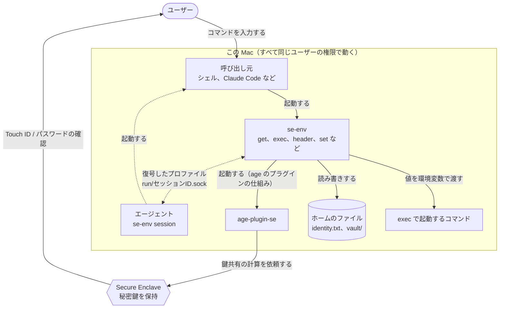
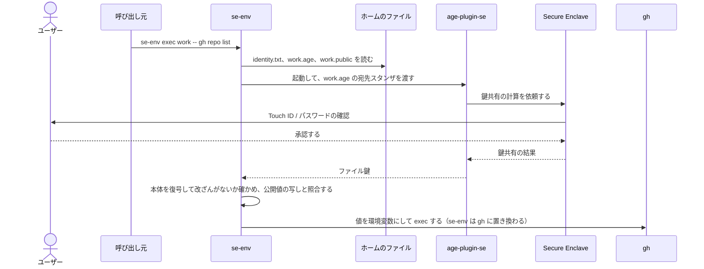
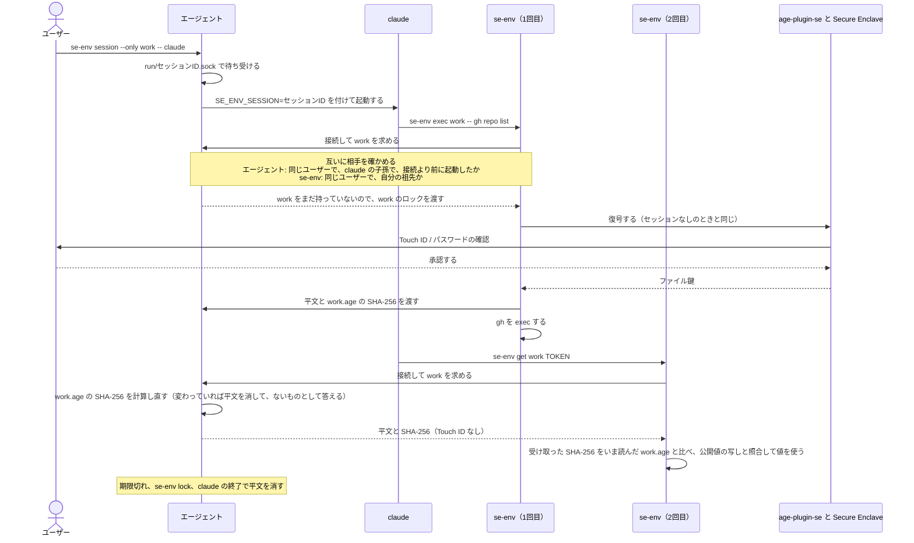
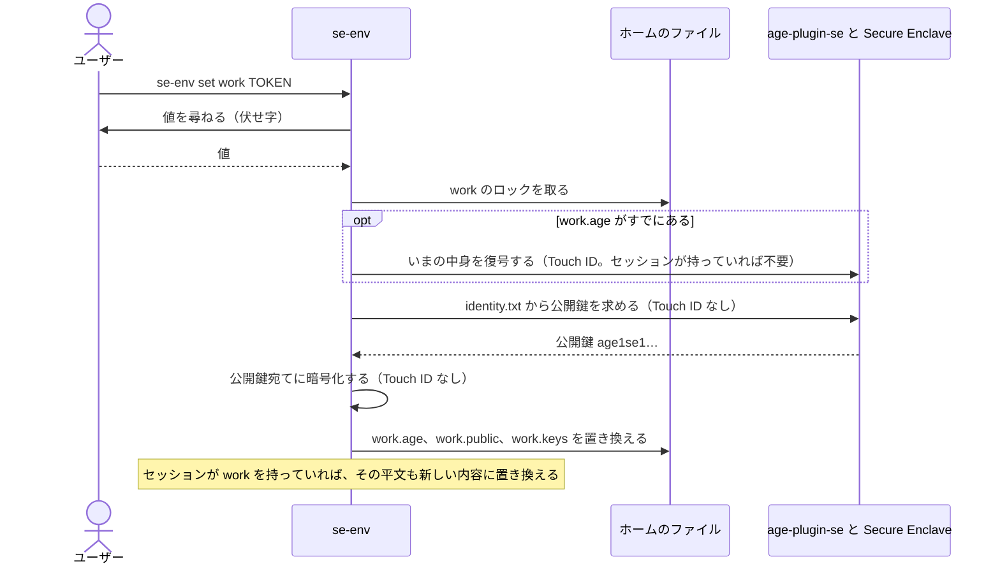
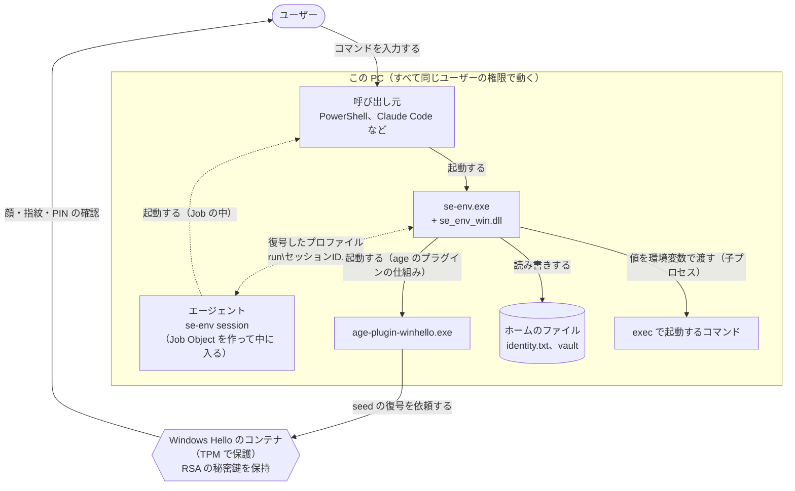

# se-env の暗号化の仕組み

[English](encryption.md) | 日本語

この文書では、se-env が何を保存し、それをどう暗号化・復号するか、セッションがどう動くか、何を守り何を守らないかを説明します。se-env は Go のプログラムです。暗号処理はすべて、バイナリに組み込んだ [age](https://github.com/FiloSottile/age) のライブラリ（フォーマット v1）と [age-plugin-se](https://github.com/remko/age-plugin-se) が行います。age-plugin-se は Apple の CryptoKit を通じて Secure Enclave を使い、age のプラグインの仕組みで別のプロセスとして起動されます。

1〜9章は macOS 版の説明です。Windows 版は鍵を TPM で守られた Windows Hello の鍵に置き換え、そのほかの部分も Windows に合わせています。違いは10章で説明します。

## 1. 構成要素と全体の流れ

| 要素 | 役割 |
|---|---|
| Secure Enclave（SE） | P-256 の秘密鍵を作って保持します。鍵は SE の外に出ず、使うたびに本人確認が必要です。 |
| age-plugin-se | SE の鍵を作り、SE に鍵共有の計算を依頼する age のプラグインです。 |
| age（ライブラリ） | ファイルを暗号化・復号します。宛先ごとの「スタンザ」を並べたヘッダーと、改ざんを検知できる本体からなります。 |
| se-env | プロファイルを管理し、値をメモリ上で扱い、環境変数でコマンドに渡し、セッションを動かします。 |
| エージェント | `se-env session` のプロセスです。セッションの間、復号したプロファイルをメモリに保持し、セッションの中で動く se-env にだけ渡します（6章）。 |
| 呼び出し元 | se-env を起動するプログラムです。ターミナルのシェルや、Claude Code のようにコマンドを実行するツールがこれに当たります。 |

### 関係図

誰が何を起動し、どこで Touch ID を求めるかを示します。点線はセッションを使うときだけの流れです。



- 秘密鍵は Secure Enclave の外に出ません。age-plugin-se が受け取るのは鍵共有の結果で、se-env が受け取るのは、そこから取り出したファイル鍵です（5章）。
- 確認を求めるのは Secure Enclave です。se-env とエージェントには、確認なしに鍵を使う方法がありません。セッションの中で Touch ID が出ないのは、鍵を使わずに、エージェントのメモリにある平文を渡すためです。

### コマンドを実行するとき（セッションなし）

`se-env exec work -- gh repo list` の例です。`get` と `header` は、最後に値をどう渡すかだけが違います（5章）。



暗号文の形式と鍵の計算は4章と5章で説明します。

### セッションの中で使うとき

`se-env session --only work -- claude` で起動した claude が、se-env を2回実行する例です。Touch ID を求めるのは1回目だけです。



エージェントがプロファイルを渡す相手の条件と、セッションが終わる条件は6章で説明します。

### 値を保存するとき

`se-env set work TOKEN` の流れです。暗号化には公開鍵しか使わないので、Touch ID を求めるのは、すでにあるプロファイルの中身を読むときだけです。



## 2. ファイル

| ファイル | 中身 | 秘密か |
|---|---|---|
| `identity.txt` | `AGE-PLUGIN-SE-1…` の行をちょうど1つ：SE の鍵を表す不透明なデータと、コメント（作成日時、アクセス制御、公開鍵）。このデータは、作成した Mac の Secure Enclave でしか使えません。 | 他では使えないが**必須**。なくすと保管庫を復号できない |
| `vault/<profile>.age` | age で暗号化したプロファイル | 暗号化済み |
| `vault/<profile>.keys` | そのプロファイルのキー名（1行に1つ）。一覧表示のための目安 | 名前だけ**平文**。値は含まない |
| `vault/<profile>.public` | そのプロファイルの公開値の写し（4章）。表示用。公開値があるときだけ存在する | **平文**。`--public` で保存した値だけが入る |
| `vault/.<profile>.lock` | 空のロックファイル。2つのコマンドが同時に同じプロファイルを書き換えないようにする | いいえ |
| `run/<id>.sock` | 動作中のセッションの Unix ソケット（6章） | いいえ。秘密はディスクに置かない |

公開鍵を入れた別のファイルはありません。公開鍵（`age1se1…`）は暗号化のたびに age-plugin-se に問い合わせて `identity.txt` から求めます。これに Touch ID は要りません。se-env 0.4 以前が作った `recipient.txt` が残っていても読まないので、削除して構いません。

`identity.txt` に置けるのは、Secure Enclave の鍵を1行だけです。ソフトウェアの鍵や他のプラグインの鍵は受け付けません。ファイルを差し替えても、気づかれずに Touch ID の要求を外すことはできません。

すべてのファイルは `umask 077`（所有者だけが読み書きできる権限）で作ります。書き込みは同じディレクトリの一時ファイルに書いてから名前を付け替えるので、プロファイルが書きかけの状態になることはありません。se-env は秘密情報を扱う前に、ホーム、`bin/`、本体、プラグイン、`identity.txt`、`vault/`、`run/` の所有者が自分（または root）で、グループや他人が書き込めないことを確かめます。そうでなければ動作を止めます。

ホームは常に、シンボリックリンクを解決した本体の1つ上のディレクトリ（`<ホーム>/bin/se-env`）です。環境変数では変えられません。

## 3. 鍵の作成（`se-env init`）

```
age-plugin-se keygen --access-control any-biometry-or-passcode
```

- SE が P-256 の鍵共有用の鍵を作ります。アクセス制御のフラグは `privateKeyUsage` と `userPresence`、アクセス可能性は `WhenUnlockedThisDeviceOnly` です。
  - `userPresence` は、Touch ID、または生体認証が使えないときのログインパスワードによる本人確認を意味します。
  - `ThisDeviceOnly` は、鍵が他の機器に同期も移行もされないことを意味します。
- SE は鍵を不透明な形で返し、それが `identity.txt` に保存されます。

## 4. プロファイルの暗号化

プロファイルはキーごとに1行の形に直します。

```
API_TOKEN=<base64(値)>
OTHER_KEY=<base64(値)>
```

base64 にするので、値に `=` や改行が含まれていても扱えます。このテキストは age のライブラリがメモリ上で暗号化します。値を平文でディスクに書いたり、他のプロセスから見えるコマンドライン引数に出したりすることは一切ありません。

```
              平文のプロファイル
                     │
age:  ファイル鍵 = ランダムな16バイト
      ├─ ヘッダー ─ 宛先スタンザ "piv-p256"（age-plugin-se が作る）:
      │     使い捨ての P-256 鍵ペア（eph）
      │     共有値   = ECDH(eph の秘密鍵, 宛先の公開鍵)
      │     包み鍵   = HKDF-SHA-256(共有値, salt = eph の公開鍵 ‖ 宛先の公開鍵, info = "piv-p256")
      │     本文     = ChaCha20-Poly1305(包み鍵, nonce = 0, ファイル鍵)
      │     ヘッダーの MAC = HMAC-SHA-256(HKDF(ファイル鍵, "header"), ヘッダー)
      └─ 本体: nonce = ランダムな16バイト
            本体の鍵 = HKDF-SHA-256(ファイル鍵, salt = nonce, info = "payload")
            ChaCha20-Poly1305 のチャンク（64 KiB ごと）を連ねた STREAM
                     │
             vault/<profile>.age
```

宛先は常に、`identity.txt` から求めた公開鍵1つだけです。暗号化に使うのはその**公開鍵**だけなので、Touch ID は要りません。新しいプロファイルへの最初の `set` で確認が出ないのはこのためです。

### 公開値

`set --public` は、秘密ではない値を保存します。たとえば、トークンの送り先の URL です。暗号化するテキストの中では、行の先頭に `+` が付きます。

```
API_TOKEN=<base64(値)>
+API_URL=<base64(値)>
```

つまり、値そのものも、それが公開値であることも、秘密と同じ暗号化の中にあります。`get`、`exec`、`header` が使う値は、この暗号化された行からしか取りません。

se-env は、公開値の行から `+` を外したものを `vault/<profile>.public` にも書きます。この平文の写しがあるので、`list` と `ls` は Touch ID なしで値を表示できます。写しを読むのはこの2つだけで、想定外の内容が混じった写しは表示もしません。

それでも se-env は写しを見張ります。写しが変わっていれば、se-env 以外のものが保管庫に書き込んだことになるからです。

- 書き込む側は、プロファイルのロックを持ったまま、暗号文と写しの両方を置き換えます。読む側は同じロックを共有で取って両方を読むので、必ず対になったものを読みます。セッションの中では、エージェントが「どの暗号文から得た内容か」（SHA-256）を応答に添えます。se-env はそれを、いま読んだファイルと比べ、違っていれば問い合わせ直します。
- 復号のたびに、またセッションからの応答のたびに、se-env は写しを、復号したプロファイルの公開値の行とバイト単位で比べます。写しがない場合は、空として扱います。
- 違っていれば、se-env は値を使う前に止まります。標準エラーにプロファイル名と食い違ったキーを出し、警告のダイアログを開き、終了コード 3 で終わります。`exec` に渡したコマンドは起動せず、`get` と `header` は何も出力しません。`set` と `rm` も拒否します。
- ダイアログは別のプロセスで、se-env が終了したあとも画面に残ります。se-env は、標準エラーを表示しないプログラムから実行されることが多いためです。ダイアログは、画面に出ている間そのプロファイル用のロックを持つので、失敗が続いてもダイアログは重なりません。
- 元に戻すには `se-env ls --verify <profile>` を使います。セッションは使わず、必ず Secure Enclave の鍵で復号します。食い違いを1つずつ表示し（写しの内容と、暗号化された正本の内容）、写しとキー名の索引を作り直します。

公開値のないプロファイルは、se-env 0.5 が書いたものとバイト単位で同じです。公開値のあるプロファイルは 0.5 では読めず、0.5 は壊れたプロファイルとして報告します。

### キー名

プロファイルは環境変数としてコマンドに渡すので、キー名は変数名として有効なものに限ります。プログラムの読み込み方や起動のしかたを変える名前は使えません。`PATH`、`HOME`、`SHELL`、`IFS`、`ENV`、`BASH_ENV`、`ZDOTDIR`、`NODE_OPTIONS`、`PYTHONPATH`、`PYTHONSTARTUP`、`PERL5OPT`、`RUBYOPT`、`GIT_SSH_COMMAND`、`AGEDEBUG` と、`DYLD_`・`LD_`・`SE_ENV_` で始まる名前です。プロファイルを読むときにも同じ検査をします。こうした名前、形式の崩れた名前、重複した名前、NUL バイトを含む値が入っているプロファイルは、どのコマンドにも渡しません。問題のキーは `se-env rm <profile> <KEY>` で削除できます。この一覧は安全網として設けたもので、危険な変数をすべて挙げたものではありません。

## 5. プロファイルの復号

```
se-env（age ライブラリ）── identity.txt で vault/<profile>.age を復号
             │  "piv-p256" スタンザを読み、プラグインを起動する
             ▼
           age-plugin-se ──► Secure Enclave
                               • 本人確認を要求  ← Touch ID / パスワードの画面
                               • 共有値 = ECDH(SE の秘密鍵, eph の公開鍵)
             ◄── 包み鍵 ── HKDF-SHA-256(...) ── ファイル鍵を取り出す
           age: ヘッダーの MAC を検証し、本体を復号しながら改ざんがないか確かめる
             │
se-env ◄── 平文（メモリ上） ── KEY と値の組に分解する
```

se-env は復号した結果を次のように使います。

| コマンド | 復号したプロファイルの使い方 |
|---|---|
| `get` | 値を1つ表示する |
| `exec` | 全キーを環境変数に加えてからコマンドを `exec` する。コマンドはそれを引き継ぐ |
| `header` | `{"<名前>":"<前置き><値>"}` を出力する（JSON として出力） |
| 既存のプロファイルへの `set` / `rm` | 組を変更して暗号化し直す（4章） |
| `ls --verify` | プロファイルに実際に入っているキー名と公開値を表示し、キー名の索引と公開値の写しを作り直す。必ず SE の鍵を使う |

`list`、`ls`、`profiles` と Tab 補完は、ファイル名と `.keys` の索引、`.public` の写ししか読みません。復号しないので、確認も出ません。索引も写しも、それ自体では改ざんを検知できないので、表示にしか使いません。キー名でない行が1つでもあれば、索引全体を使いません。形式の崩れた写しは表示しません。

プラグインは `PATH` から名前で起動されます。そこで se-env は自分の `PATH` をプラグインのあるディレクトリ1つだけに絞ります（`<ホーム>/bin` を優先し、なければ `PATH` の絶対パスのディレクトリ）。`exec` と `session` で起動するコマンドには、元の `PATH` を戻して渡します。また、se-env は自分の環境から `AGEDEBUG` を消します。`AGEDEBUG=plugin` があると、age のライブラリがプラグインとの通信を、ファイル鍵も含めて stderr に出すためです。ダイアログには常に `/usr/bin/osascript` を使い、`PATH` からは探しません。

Touch ID のダイアログはプラグインが出すので、macOS が表示する名前は「age-plugin-se」だけです。誰が何のために求めているかを示すため、se-env はプラグインを起動する間だけ `SE_ENV_AUTH_REASON` に文を入れます。`patches/age-plugin-se-reason.patch` を当てたプラグイン（[build_mac.ja.md](build_mac.ja.md)）は、その文をダイアログに出します。

```text
“age-plugin-se”で次の操作を実行しようとしています:
要求元: Ghostty › login › zsh › claude › zsh › se-env
対象: プロファイル「work」のすべてのキー
操作: 環境変数にしてコマンド「gh repo list」に渡す
許可後: claude (PID 4242) のセッションが 15:30 までこのプロファイル全体を保持し、…（セッションの中だけ）

実行するには認証してください
```

- 「要求元」は、se-env を起動したプロセスを外側から順に並べたものです。アプリケーションの中のプログラムはバンドルの名前、それ以外は起動したときの名前で表示します。最大 8 個まで出します。
- プラグインがこの文を使うのは、親プロセスがプラグインと同じディレクトリにある `se-env` のときだけです（`proc_pidpath` で実行ファイルの実際のパスを比べます）。プラグインを直接起動したプログラムには、パッチがないときと同じ macOS の既定のダイアログが出ます。
- se-env は起動したときと使い終わったときに、この変数を自分の環境から消します。`exec` や `session` で起動するコマンドには渡しません。
- 表示する名前は自己申告で、証明ではありません。同じユーザーで動くプログラムは、自分の名前を選んだり、紛らわしい名前のシンボリックリンクから起動したりできます。このダイアログは、心当たりのない要求に気づくためのもので、要求元を認証するものではありません。

## 6. セッション

`se-env session [--only p1,p2] [--ttl 30m] -- <コマンド>` を使うと、選んだプロファイルは最初の1回のあと Touch ID を省けます。

`se-env session` のプロセスは、`<コマンド>` が動いている間ずっと残り、ssh-agent と同じように**エージェント**として働きます。

1. 復号したプロファイルは**エージェントのメモリにだけ**置きます。ディスクには何も書かず、セッション鍵もありません。`SE_ENV_SESSION` に入っているのはセッション ID（ランダムな8バイト）だけで、se-env がどのソケットを使うかを示します。秘密ではありません。
2. エージェントは Unix ソケット `run/<id>.sock`（権限 0600。ディレクトリは 0700）で待ち受けます。macOS ではソケットのパスは104バイトまでなので、ホームのパスは77文字以内にしてください。それより長いと、se-env はセッションを始めません。エージェントは接続のたびに、誰が接続してきたかをカーネルに尋ね（`LOCAL_PEERCRED`、`LOCAL_PEERPID`）、そのプロセスをカーネルのプロセス表で調べます。プロファイルを渡したり受け取ったりするのは、相手が次の条件をすべて満たすときだけです。
   - 同じユーザーで動いている
   - `<コマンド>` 自身か、その子孫である（親プロセスをたどると `<コマンド>` に行き着く）
   - 接続を受け付けた時点より前に起動している（使い回されたプロセス ID は数えない）

   したがって、別のプロセスが `SE_ENV_SESSION` を設定しても何も得られません。親がすべて終了したプロセス（launchd の子に付け替えられたデーモン）は、セッションに属さなくなります。

   se-env の側も相手を確かめます。ソケットからプロファイルを読んだり、ソケットへ渡したりするのは、そこで待ち受けているプロセスが同じユーザーで、かつ se-env 自身の祖先であるときだけです。自分のセッションのエージェントは必ず祖先に当たります。別のプログラムが `run/` に置いた偽のソケットは信用しません。
3. 許可したプロファイルを最初に復号するとき、se-env は次の処理をします。
   - エージェントに問い合わせます。まだ何も持っていないので、エージェントは呼び出し元にプロファイルごとのロックを渡します。他の呼び出しは待つので、複数のコマンドが同時に起動しても Touch ID は1回で済みます。ロックは接続に結び付いていて、呼び出し元がどんな理由で終了しても解放されます。
   - SE で復号します（5章）。ここで確認が出ます。
   - 平文と、復号した `vault/<profile>.age` の SHA-256 をエージェントに渡します。
4. 2回目以降はメモリから応答します。そのたびにエージェントは今の `vault/<profile>.age` のハッシュを計算します。ファイルが変わっていれば、エージェントはその内容を消去し、se-env が SE で復号し直します。se-env 経由の `set` はすでにある内容を更新します。このセッションで復号していないプロファイルを新しく加えることはありません。
5. 期限と対象はエージェントが持ち、セッションの開始後は変えられません。
   - `--ttl`（既定は30分、最長24時間）は実際の時刻で数えます。Mac がスリープしている時間も含みます。期限が過ぎると、エージェントはメモリを消去し、ソケットを削除します。
   - `--only` は、要求のたびにエージェントが確かめます。それ以外のプロファイルは毎回 Touch ID を求めます。
6. キャッシュは次のときにも終わります。
   - `<コマンド>` が終了した（エージェントはメモリを消去して終了する）
   - `se-env lock` を実行した（キャッシュを捨てる。セッションは続く）
   - `se-env cache rm` を実行した（Touch ID で確認してからセッションを終える。コマンドは動き続け、以後は毎回 Touch ID を求める）
   - エージェントが強制終了された（メモリごと消える。残ったソケットは、se-env が次に見つけたときに削除する）

`se-env cache list` はセッションの外からも使えます。同じユーザーのプロセスなら、エージェントに情報（ID、コマンド、開始、期限、対象、キャッシュ済みのプロファイル名）を尋ねたり、キャッシュを捨てるよう伝えたりできます。どちらも値は明かしません。キャッシュを捨てても、se-env が再び Touch ID を求めるようになるだけです。

## 7. 削除での本人確認

削除は確認ダイアログだけにもセッションにも頼りません。次のどれも Secure Enclave の鍵を必要とするので、セッションの中でも Touch ID が出ます。

| コマンド | 確認の内容 |
|---|---|
| `rm <profile> <KEY>…` | SE の鍵でプロファイルを復号する（セッションのキャッシュは使わない） |
| `rm --all`、`rm-profile --force` | `y/N`（またはダイアログ）で尋ねてから、下の本人確認をする |
| `rm-profile` | 尋ねてから、SE の鍵でプロファイルを復号し、本当に空であることを確かめる（索引は目安にすぎない） |
| `cache rm` | 下の本人確認をする |
| `destroy` | `y/N`、確認用の文字列の入力、10秒の待機のあと、下の本人確認をする |

本人確認ではランダムな24バイトを `identity.txt` から求めた公開鍵宛てに暗号化し、SE の鍵で復号して一致を確かめます。これで必ず Touch ID の確認が出ます。

さらに `destroy` は、端末がない場合とセッションの中では実行を拒否します。また、何かを消す前に、動作中のセッションをすべて終わらせます。

これらの確認は、se-env 自体が無人で秘密情報の削除に使われること（たとえば、あなたの代わりにコマンドを実行するツールによるもの）を防ぎます。ファイルを直接消すプログラムへの防壁ではありません。あなたの権限で動くものなら、それはできてしまいます。

## 8. 脅威モデル

### 守れるもの

- 保存中の秘密情報：平文をディスクに書きません。セッションも同じです。保管庫やそのバックアップ・コピー（Time Machine、ディスクイメージ、盗まれたディスク）は、この Mac の Secure Enclave とあなたの本人確認がなければ復号できません。
- 他の Mac と他のユーザー：SE の鍵は端末に縛られ、ファイルは所有者だけが読めます。そうなっていなければ se-env は動作を止めます。
- セッション外での無断の利用：あなたの権限で動くプロセスが se-env を起動することはできますが、復号のたびにシステムの確認画面が出るので、拒否できます。
- セッションの外にいるプロセス：セッションのキャッシュはエージェントのメモリにあり、セッションのコマンドの配下で起動したプロセスにしか渡しません。環境変数に鍵はなく、キャッシュのファイルもないので、他のプロセスの環境変数（`ps -wwE`）や `run/` のファイルを読んでも何も得られません。
- セッションの制限：期限と `--only` はエージェントの中にあります。セッション内のプロセスが延長したり対象を広げたりすることはできません。
- 暗号文の改ざん：age はヘッダーと本体の改ざんを検知します。書き換えられたファイルは復号に失敗します。
- 公開鍵の差し替え：プロファイルの宛先は `identity.txt` から求めた鍵だけです。ファイルを足して宛先を増やすことはできません。
- 秘密の送り先：URL のような公開値は、暗号化されたプロファイルからだけコマンドに渡り、平文の写しからは渡りません。写しを書き換えても、トークンの送り先は変えられません。書き換えは次の復号で見つかり、se-env は何も実行せずに知らせ、終了コード 3 で終わります（4章）。
- コマンドライン：値をコマンドの引数に入れることはありません。引数はこの Mac のどのユーザーでも `ps` で見られるためです。値はメモリ上で扱い、コマンドには環境変数でだけ渡します。

### 守れないもの・限界

- セッションの中：セッションのコマンドの配下で起動したプロセスは、どれも確認なしにキャッシュ済みのプロファイルを読め、`set` で書き換えることもできます。セッションはそのためのものです。そこで起動したツールやエージェント、それらが実行するものも含みます。`--only` は作業に必要なプロファイルだけにし、期限は短くし、終わったら `se-env lock` か `cache rm` を実行してください。
- セッションのプロセスツリーに入り込む：あなたの権限で動くプログラムは、セッションに属していると名乗るだけでは通りません。しかし、セッション内のプログラムに自分を起動させること（たとえば、そのプログラムが実行するスクリプトや設定ファイルを書き換える）や、macOS がデバッグを許している場合にデバッガでセッション内のプロセスを乗っ取ることは試せます。同じ能力があれば、エージェントのメモリも読めます。セッションはキャッシュを読める相手を絞るもので、サンドボックスではありません。
- 値を渡したあと：値をコマンドに渡すと、そのコマンドとそこから起動されたものは、値を読んだり、記録したり、外部へ送ったりできます。
- 動作中のコマンドの環境変数：macOS では、あるプロセスの環境変数を、同じユーザーの別のプロセスが読めます（`ps -wwE`）。隠されるのは Apple のシステムのプログラムだけです。そのため、`exec` がコマンドの環境変数に入れた値は、そのコマンドが動いている間、あなたの権限で動くものなら確認なしに読めます。セッションを使っても変わりません。セッションが環境変数から外しているのはセッションのキャッシュで、`exec` がコマンドに渡す値ではありません。秘密を持つコマンドはできるだけ短時間で終わるものにしてください。`header` は、値を環境変数ではなく標準出力で渡します。
- 別の場所で export している秘密：シェルの起動ファイルで export したままの秘密や、親プロセスで設定された秘密は、se-env では守れません。そうした値は起動するすべてのプログラムの環境変数に入ります。秘密を se-env に移したら、古い `export` を削除し、秘密を再発行し、ターミナルと長時間動いているプログラムを起動し直してください。起動ファイルを直しても、動作中のプロセスは起動したときの環境変数を持ち続けます。
- あなたの権限で動くマルウェアは、自分が起こした確認画面をあなたが承認するのを待ったり、承認するよう誘導したりできます。se-env の本体、プラグイン、`identity.txt`（どれもあなたの所有物）を差し替えることも、保管庫を消すこともできます。確認画面は足止めにはなりますが、隔離の境界ではありません。
- 送り手の認証はありません。age は、ファイルが書き換えられていないことは保証しますが、誰が作ったかは保証しません。`vault/` に書き込める人は、あなたの公開鍵宛てに暗号化した別の内容にプロファイルを差し替えられます。se-env は、拒否するキー名（4章）を除いて、それを受け入れます。ホームのディレクトリはあなただけが書き込める状態にしておいてください。
- 差し替えられたプロファイルは、独自の公開値と、それに合った写しを持てます。4章の照合では、あなたが書いたプロファイルと見分けられません。ただし、あなたの秘密は入れられないので、最初に現れる兆候は、キーがなくなっていることや、コマンドが認証に失敗することです。そのときは、秘密を登録し直す前に `se-env ls --verify <profile>` を実行して、公開値を読んでください。確かめずに登録し直すと、新しい秘密が、差し替えられたプロファイルの URL と一緒に使われます。
- 公開値は平文でディスクにあります（`.public`）。あなたのファイルを読めるものなら読めます。`list` と `ls` が表示する値はこの写しから読んだもので、次に復号するまで照合されていません。
- キー名は平文（`.keys`）なので、確認なしに一覧できます。
- パスワードでの代用：`any-biometry-or-passcode` では、ログインパスワードでも本人確認が通ります。
- メモリ：Go では、値のコピーがすべて消えることまでは保証できません。se-env は、セッションのキャッシュを捨てるときに上書きし、コアダンプも無効にしていますが、解放済みのメモリには、プロセスが終わるまで値が残ることがあります。
- 可用性：Mac を失ったり初期化したりすると、保管庫は二度と復号できません。復旧用の鍵はなく、これは意図した仕様です。秘密情報を再発行できる状態にしておいてください。

## 9. ビルドの完全性

se-env にビルド用のスクリプトはありません。[build_mac.ja.md](build_mac.ja.md) に、手で実行する数個のコマンドを載せています。`go mod verify` ですべての Go モジュール（age のライブラリを含む）を `go.sum` に固定されたハッシュと照合し、`GOTOOLCHAIN=local`（ツールチェーンを自動でダウンロードしない）と `GOFLAGS=-mod=readonly` で se-env をビルドします。age-plugin-se は決められたコミットを新しい空のディレクトリに取得します。コミットハッシュが一致することと、**チェックアウトの中にそれ以外のファイルがないこと**を確かめ、`patches/age-plugin-se-reason.patch` を当てて変わったのが `Sources/Crypto.swift` だけであることを確かめてから、パッケージマネージャを使わずに `swiftc` で直接ビルドします。関わるコードは se-env のバイナリとこのプラグインだけです。

## 10. Windows での仕組み

Windows 版の se-env は macOS 版と同じコマンドで使え、プロファイルの形式（4章の行の形式と age のファイル）も同じです。違うのは、鍵を置く場所、本人確認の出し方、セッションのメンバーの見分け方、同じユーザーのほかのプログラムへの備えです。この章では Windows でそれぞれをどう守っているかを説明します。設計の経緯と実機での検証の記録は [design-windows-hello.ja.md](design-windows-hello.ja.md) にあります（以下の V1〜V19 は、その10章の項目です）。

### 10.1 構成要素

| 要素 | 役割 |
|---|---|
| Windows Hello のコンテナ | ユーザーごとに Windows が持つ鍵の保管場所です。TPM で保護されます。se-env の RSA の秘密鍵はここにあり、外に出ません。使うたびに顔・指紋・PIN の確認を求めます。 |
| `age-plugin-winhello.exe` | Hello の鍵を作り、その鍵での復号をコンテナに依頼する age のプラグインです（Rust）。macOS の age-plugin-se に当たります。 |
| `se_env_win.dll` | se-env が使う Windows API の呼び出し（ACL、ファイルのロック、プロセスの保護、Job Object、ソケットの相手、メモリの暗号化）をまとめた DLL です（Rust）。 |
| `se-env-ui.exe` | 伏せ字の入力、確認、改ざんの警告のダイアログです（Rust）。macOS の `osascript` に当たります。 |
| `se-env.exe` | macOS 版と同じ Go のソースから作る本体です。 |



### 10.2 鍵

`se-env init` はプラグインに鍵を作らせます。鍵は CNG の「Microsoft Passport Key Storage Provider」（Windows Hello の鍵の置き場所）に作る RSA 2048 ビットの鍵です。

| 設定 | 値 | 意味 |
|---|---|---|
| `Key Usage` | 復号だけ | 署名には使えない |
| `NgcCacheType` | 1（認証必須） | 使うたびに Hello の確認が出る。この設定は鍵に付いていて、呼び出し側からは外せない（V14） |
| `Export Policy` | 0 | 秘密鍵を取り出せない |

- 鍵を作る前に、PC に TPM 2.0 があることを確かめます。作ったあとと使う前には、鍵がハードウェアに置かれていること（`NgcKeyImplType` のハードウェアのフラグ）を確かめ、ソフトウェアの鍵は使いません。
- 鍵を作ったら、すぐに1回、実際に復号できることを確かめます。そのため `init` では Hello の確認が2回出ます。
- 確認の方法は Hello に設定した顔・指紋・PIN です。PIN は常に使えます。PIN の総当たりは TPM が防ぎます。

### 10.3 暗号化と復号

このプロバイダーが復号に使えるパディングは PKCS#1 v1.5 だけです（OAEP は拒否されます）。そこで、RSA でファイル鍵を直接包むことはしません。RSA で運ぶのは乱数の種（seed）だけで、ファイル鍵は seed から作った鍵で認証付き暗号にかけます。

```
pub    = 鍵の公開部分（BCRYPT_RSAPUBLIC_BLOB）
宛先    age1winhello1… = bech32(2 ‖ pub)

age:  ファイル鍵 = ランダムな16バイト
      └─ 宛先スタンザ "winhello <tag>"（age-plugin-winhello が作る）:
            seed   = ランダムな32バイト
            包み鍵  = HKDF-SHA-256(seed, salt = SHA-256(pub), info = "se-env/winhello/v2/wrap")
            本文    = RSA-PKCS1(pub, seed) ‖ ChaCha20-Poly1305(包み鍵, nonce = 0, ファイル鍵)
            tag    = SHA-256(pub) の先頭4バイト
      本体とヘッダーの MAC は 4章と同じ
```

- 暗号化に使うのは公開鍵だけなので、Hello の確認は出ません。macOS と同じく、新しいプロファイルへの最初の `set` では確認が出ません。
- 復号では、プラグインがスタンザの RSA の部分を Hello のコンテナに渡し、確認のあとで seed を受け取ります。秘密鍵はコンテナから出ません。プラグインが手にするのは seed、se-env が手にするのはファイル鍵だけです。
- seed はファイルごとに違います。漏れても、そのファイルが読めるだけです。
- seed が正しく取り出せたかは、ChaCha20-Poly1305 の検証で確かめます。PKCS#1 v1.5 への既知の攻撃は、復号を何度も試せることが前提です。ここでは1回の復号ごとに Hello の承認が要るので、その攻撃は成り立ちません。
- `tag` があるので、プラグインは自分の鍵宛てでないスタンザでは確認を出しません。

`identity.txt` には鍵の名前と公開鍵の SHA-256 を入れた `AGE-PLUGIN-WINHELLO-1…` の行を1つだけ置きます。秘密ではありませんが、なくすと保管庫を復号できません。プラグインは公開鍵を求めるときも復号するときも、確認を出さずに次のことを確かめます。

- `identity.txt` が示す名前の鍵がこのユーザーの Hello のコンテナにある
- その公開鍵の SHA-256 が `identity.txt` と一致する
- その鍵が今も「取り出せない」「使うたびに認証必須」で、ハードウェアにある

`identity.txt` を書き換えて別の鍵宛てに暗号化させるには、攻撃者は Hello のコンテナに自分の鍵を作る必要があり、それには Hello の確認が出ます。確認なしで使える鍵やソフトウェアの鍵は、上の確認で拒否されます。

### 10.4 Hello のダイアログ

se-env は macOS と同じく、プラグインを起動する間だけ `SE_ENV_AUTH_REASON` に「要求元・対象・操作」の文を入れます。プラグインはその文を Hello のダイアログに出します（CNG の `Use Context`）。

- プラグインがこの文を使うのは、親プロセスがプラグインと同じディレクトリの `se-env.exe` のときだけです。実行ファイルの実際のパスと、親が自分より先に起動したことを確かめます。そうでないときは「se-env から起動されていない」という文を出します。
- 文とは別に、Windows が要求元のアプリ名を表示します。se-env からの要求なら `age-plugin-winhello` です。
- 同じユーザーのほかのプログラムもこの鍵で復号を求め、好きな文を出せます（V14 で、偽の「se-env: get work/TOKEN」がそのまま出ることを確かめました）。ただし、確認そのものは省けません。ダイアログの文だけを信用せず、自分が今その操作をしたかどうかで判断してください。
- 顔認証は、ダイアログが出た瞬間に自動で承認することがあります（V14 の検証中にも起きました）。心当たりのない要求を見てから拒否したいなら、PIN か指紋を使ってください。

### 10.5 ファイルと権限

Windows には `umask` がないので、ACL で同じことを確かめます。

- se-env は秘密を扱う前に、ホーム、`bin`、`se-env.exe`、プラグイン、`se-env-ui.exe`、`se_env_win.dll`、`identity.txt`、`vault`、`run` を調べます。所有者が自分、SYSTEM、Administrators、TrustedInstaller のどれかで、それ以外の誰にも書き込みの権限がないことを確かめ、そうでなければ動作を止めます。
- `init` は `vault` に、`run` はセッションを始めるときに、継承を切った ACL（自分、SYSTEM、Administrators だけ）を付けます。
- `se_env_win.dll` は、`se-env.exe` と同じディレクトリから絶対パスで読み込みます。ほかの場所は探しません。保護をかけるために起動の直後に読み込むので、上の確認はそのあとになります。`bin` にほかの人が書き込めるなら、`se-env.exe` 自体も差し替えられるので、確認の順番で守れる範囲は変わりません。
- ホームは `%LOCALAPPDATA%\se-env` に置くのを前提にしています。システム以外のドライブは、Authenticated Users に変更を許していることが多いので、ビルドしたディレクトリをそのままホームにはしないでください。

### 10.6 プログラムの起動と環境変数

Windows では、プログラムが別のプログラムを起動するときに、カレントディレクトリや同じディレクトリを先に探すことがあります。se-env はそれぞれ次のように探す場所を絞っています。

| 起動するもの | 対策 |
|---|---|
| プラグイン | macOS と同じく、`PATH` をプラグインのディレクトリ1つに絞る。加えて `NoDefaultCurrentDirectoryInExePath` を設定し、カレントディレクトリを探さないようにする。`GODEBUG` は se-env 自身の環境から外す（`execerrdot=0` などで Go の安全確認を外させないため）。どちらも `exec` と `session` のコマンドには元のまま渡す |
| プログラムが読み込む DLL | Rust の3つのプログラムと DLL は、インポートする DLL を System32 だけから読み込む（`/DEPENDENTLOADFLAG:0x800`）。この指定がないと、`ncrypt.dll` や `tbs.dll` などを、プログラムと同じディレクトリから先に探す（V18） |
| `exec` と `session` のコマンド | カレントディレクトリと相対パスの `PATH` からは探さない |
| ダイアログ | `se-env.exe` と同じディレクトリの `se-env-ui.exe` だけを使う |

キー名は4章の一覧に加えて、Windows でプログラムの起動のしかたを変える名前も拒否します。`PATHEXT`、`COMSPEC`、`PSModulePath`、`SystemRoot`、`windir`、`TEMP`、`TMP`、`HOMEDRIVE`、`HOMEPATH`、`ProgramFiles`、`__COMPAT_LAYER`、`PSExecutionPolicyPreference`、`NoDefaultCurrentDirectoryInExePath`、.NET のプロファイラや起動時のフックなどです。Windows の環境変数は大文字と小文字を区別しないので、名前も区別せずに比べます。

Windows には `exec` がありません。`se-env exec` はコマンドを子プロセスとして起動し、終わるのを待って、その終了コードを返します。値はコマンドが終わるまで se-env のメモリに残るので、次の節の保護で守ります。

### 10.7 同じユーザーのほかのプログラムへの備え

macOS は同じユーザーのプロセスどうしでも、メモリを読むことを標準では許しません。Windows は許します。昇格していないプログラムでも、同じユーザーのプロセスを開いてメモリを読み、ハンドルを複製し、スレッドを乗っ取れます。そこで se-env（すべてのコマンド）、プラグイン、`se-env-ui.exe` は、起動した直後に自分を次のように保護します。

| 保護 | 内容 |
|---|---|
| プロセスの ACL | ほかのプロセスに許すのは、状態の問い合わせ、終了の待機、強制終了だけ。メモリの読み書き、ハンドルの複製、スレッドの作成、親としての利用はできない。所有者が ACL を戻すことも防ぐ |
| スレッドの ACL | 許すのは問い合わせと待機だけ。一時停止やレジスタの読み書きはできない。あとから増えたスレッドにも付くよう、プロセスが動いている間ずっと付け直す（Go のランタイムのスレッドは 50 ミリ秒以内、それ以外は2秒以内） |
| 緩和ポリシー | ASLR の強制、AppInit DLL やウィンドウフックなど古い仕組みでの DLL の読み込みの禁止、ネットワーク上の DLL の禁止、Microsoft の署名がない DLL の禁止、実行可能なメモリを新しく作ることの禁止 |
| Control Flow Guard | Rust の部分は、間接呼び出しの行き先を関数の入口に限る |
| セッションのキャッシュ | エージェントは、復号したプロファイルを `CryptProtectMemory` で暗号化して持ち、要求に応えるときだけ復号する。暗号化できなければキャッシュしない |
| ダンプ | Windows エラー報告のダンプにヒープを入れない |
| 保護に失敗したとき | se-env は保管庫を使うコマンドを実行しない。プラグインは何もせずに終了する。`se-env-ui.exe` は値の入力を受け付けない |

実機で、se-env が動き出したあとに来た、昇格していない同じユーザーのプロセスからは、メモリの読み取り、ハンドルの複製、スレッドの作成とスレッドの乗っ取りが拒否されることを確かめました（V9）。

ただし、これは攻撃を難しくするための備えで、**同じユーザーのマルウェアに対する境界ではありません**。実機で次のことを確かめています。

- プロセスを起動してから保護がかかるまでの約 0.1 秒（V15）は、ほかのプロセスが全権で開けます。そのとき開いたハンドルは、保護のあとも使えます。
- se-env を起動したプログラム（シェルなど）と、コンソールのホスト（`conhost.exe`）は、se-env への全権のハンドルを持っています（V16）。どちらも保護されていない同じユーザーのプロセスなので、そこに入り込めば se-env のメモリを読めます。
- `exec` と `session` で起動する子プロセスはふつうのプロセスです（V17）。同じユーザーのプログラムはそのメモリと環境変数を読めます。

根本的に防ぐには、秘密を扱う処理を、作るときから保護した別のプロセスに分ける必要があります。現在の se-env ではそこまでしていません。

### 10.8 セッション

キャッシュの持ち方、期限、`--only`、`lock`、`cache rm`、暗号文の SHA-256 による照合は、6章と同じコードです。違うのは、セッションのメンバーの見分け方です。

- Windows では親プロセスを偽って起動できます。また、親が終了しても子の「親の PID」は残り、その PID はほかのプロセスに使い回されます。そのため、macOS のように親をたどる方法は使えません。
- 代わりに **Job Object** を使います。エージェントは名前のない Job を作って自分をその中に入れ、それからセッションのコマンドを起動します。Job の中のプロセスが起動したプロセスは、自動的に同じ Job に入ります。Job は抜けることを許可していないので、子孫は Job から出られません。
- エージェントは接続してきた相手の PID をソケットから得て（`SIO_AF_UNIX_GETPEERPID`）、相手が同じユーザーか（トークンのユーザー SID）と、Job の中にいるか（`IsProcessInJob`）を確かめます。PID が使い回されても、Job の中にいるのはセッションの子孫だけなので、問題になりません。
- 通信には macOS と同じく AF_UNIX のソケット（`run\<id>.sock`）を使います。`run` は継承を切った ACL を持ちます。se-env の側も、待ち受けているのが同じユーザーで自分の祖先であるときだけ使います。親をたどるときは、親の起動時刻が子より後なら PID の使い回しとみなして止まります。

セッションの中でそのまま使えることを、Git for Windows の `sh`、cmd、PowerShell、Node.js、Claude Code で確かめました（V11）。Windows が別に起動するプログラムは Job に入りません。セッションの中から Windows Terminal の新しいウィンドウを開くと、その中のシェルはセッションの外になります。Windows Terminal ではタブの中で `se-env session` を起動してください。

セッションの中のコマンドはふつうのプロセスなので（10.7節）、同じユーザーのプログラムはそこに入り込むか、そのプロセスを親に指定して自分を起動すれば、メンバーとして扱われます。そうすれば、Hello なしでキャッシュ済みのプロファイルを受け取れます。Windows のセッションは同じユーザーのマルウェアに対する境界ではありません。`--only` と `--ttl` を絞ることが、被害の範囲を決めます。

### 10.9 使える場面と、鍵を失う操作

- Hello の確認は PC の前でサインインしているデスクトップにしか出ません。SSH の中では確認の要らない操作（`list`、`ls`、公開鍵を求めること）だけが動きます。リモートデスクトップの中では鍵の作成も復号も `0x80090010`（アクセス拒否）で失敗します（V13）。
- Hello の PIN を**変更**しても、鍵は残ります。
- Hello の PIN を**削除**すると鍵は消え、設定し直しても戻りません。TPM を**クリア**すると、鍵は名前だけ残り、使えなくなります（V12）。どちらの場合も、保管庫は二度と復号できません。se-env は復号に失敗したとき、確認を出さずにプラグインに鍵の状態を尋ね、鍵が失われていればそう表示します。秘密の値は元の発行元で作り直せるようにしておいてください。

### 10.10 脅威モデルの差分

8章から変わるところだけを書きます。

#### 守れるもの

- 秘密鍵は Hello のコンテナから出ず、se-env やプラグインのメモリに出ません。同じユーザーのプログラムが se-env のファイルやメモリをすべて読めたとしても、鍵は手に入りません。手に入るのは、そのとき扱っていたファイル鍵と値だけです。
- 鍵が黙って使われることも防げます。鍵を使うたびに Hello の確認が出ます。この確認は鍵の設定で強制され、se-env 以外のプログラムが呼び出しても省けません（V14）。

#### 守れないもの・限界

- 同じユーザーのマルウェアに対しては、10.7節と10.8節のとおり、プロセスの保護もセッションも境界になりません。保護をかける前に開いたハンドル、シェルや `conhost.exe` が持つハンドル、セッションのプロセスへの入り込みを通して、値を読まれることがあります。
- マルウェアは自分で復号を求め、好きな文のダイアログを出して、あなたが承認するのを待ったり、承認するよう誘導したりできます。
- `bin` の中のファイルと `identity.txt` は、あなたの権限で書き換えられます。差し替えられた se-env は次にあなたが承認したときに値を持ち出せます。
- 管理者として昇格し、`SeDebugPrivilege` を持つプログラムは、10.7節の保護をすべて越えられます。
- `se-env set` で値を入力するときのキー入力は、同じユーザーのキーロガーから守れません。
- 10.9節のとおり、SSH とリモートデスクトップでは使えず、PIN の削除や TPM のクリアで保管庫を失います。

### 10.11 ビルドの完全性

Windows 版の手順は [build_win.ja.md](build_win.ja.md) にあります。Go の部分は9章と同じく `go mod verify` で照合し、`GOTOOLCHAIN=local` と `GOFLAGS=-mod=readonly` でビルドします。Rust の部分は `cargo build --locked` で、`Cargo.lock` に固定したバージョンとハッシュのクレートだけを使います。C ランタイムは静的にリンクします（起動後は Microsoft の署名がある DLL しか読み込めないため）。DLL を System32 から読み込む指定と Control Flow Guard は `win/.cargo/config.toml` で有効にしていて、`dumpbin /loadconfig` で確かめられます。
