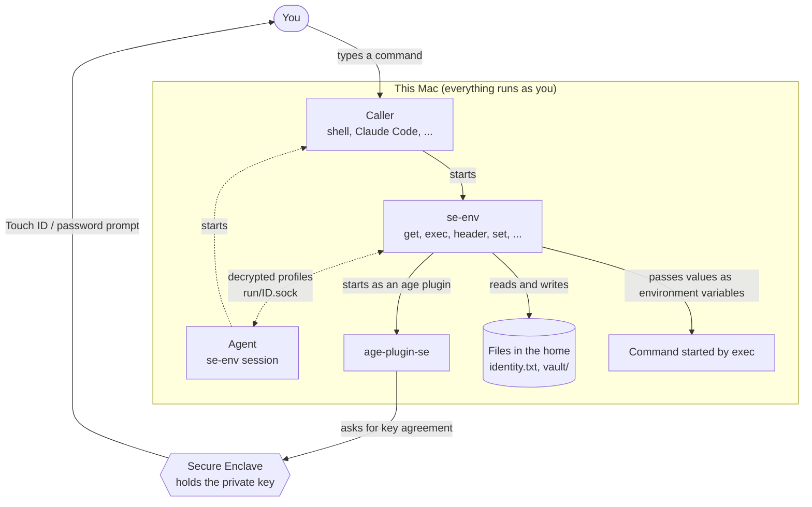
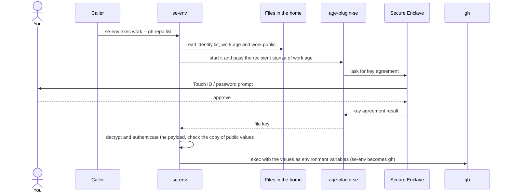
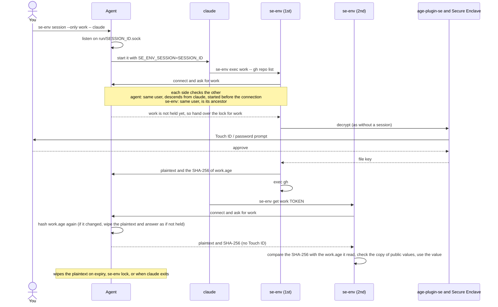
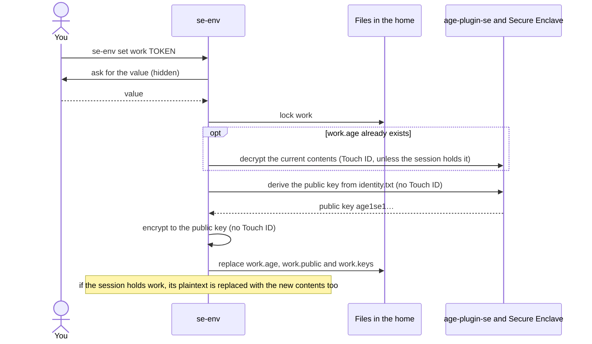

# How se-env encrypts your secrets

English | [日本語](encryption.ja.md)

This document describes what se-env stores, how it is encrypted and decrypted, how sessions work, and what is (and is not) protected. se-env is a Go program. All cryptography is done by the [age](https://github.com/FiloSottile/age) library (format v1), linked into the binary, and by [age-plugin-se](https://github.com/remko/age-plugin-se), which talks to the Secure Enclave through Apple's CryptoKit. age runs the plugin as a separate process through its plugin protocol.

## 1. Components and how they work together

| Piece | Role |
|---|---|
| Secure Enclave (SE) | Generates and holds the P-256 private key. The key never leaves the SE, and every use requires user presence. |
| age-plugin-se | age plugin that creates SE keys and asks the SE to perform key agreement. |
| age (library) | Encrypts and decrypts files: header with one stanza per recipient, plus an authenticated payload. |
| se-env | Manages profiles, keeps values in memory, hands them to commands through environment variables, and runs sessions. |
| Agent | The `se-env session` process. For the life of a session it keeps decrypted profiles in memory and hands them only to se-env processes running inside the session (§6). |
| Caller | The program that starts se-env: a terminal shell, or a tool that runs commands for you such as Claude Code. |

### Overview

Who starts what, and where Touch ID is asked for. Dotted lines are used only with a session.



- The private key never leaves the Secure Enclave. age-plugin-se receives the result of the key agreement, and se-env receives the file key unwrapped with it (§5).
- The prompt comes from the Secure Enclave. Neither se-env nor the agent has a way to use the key without it. Inside a session there is no prompt because the key is not used: the agent hands over the plaintext it holds in memory.

### Running a command (no session)

`se-env exec work -- gh repo list` as an example. `get` and `header` differ only in how the value is handed over at the end (§5).



The ciphertext format and the key derivation are in §4 and §5.

### Inside a session

claude, started with `se-env session --only work -- claude`, runs se-env twice. Only the first run asks for Touch ID.



Who the agent hands profiles to, and when a session ends, are in §6.

### Saving a value

`se-env set work TOKEN`. Encryption uses only the public key, so Touch ID is asked for only to read an existing profile.



## 2. Files

| File | Contents | Secret? |
|---|---|---|
| `identity.txt` | Exactly one `AGE-PLUGIN-SE-1…` line: an opaque blob for the SE key, plus comments (creation date, access control, public key). The blob can be used only by the Secure Enclave of the Mac that created it. | Not usable elsewhere, but **required**: without it the vault cannot be decrypted. |
| `vault/<profile>.age` | age-encrypted profile. | Encrypted |
| `vault/<profile>.keys` | Key names of the profile, one per line. Only a hint for listing. | **Plaintext** names, no values |
| `vault/<profile>.public` | Copy of the public values of the profile (§4), for display. Exists only if the profile has one. | **Plaintext**. Holds only values stored with `--public` |
| `vault/.<profile>.lock` | Empty lock file, so two commands cannot change one profile at the same time. | No |
| `run/<id>.sock` | Unix socket of a running session (see §6). | No. Nothing secret is on disk |

There is no separate public-key file. The public key (`age1se1…`) is derived from `identity.txt` every time se-env encrypts, by asking age-plugin-se; this needs no Touch ID. A `recipient.txt` left by se-env 0.4 or earlier is ignored and can be deleted.

se-env accepts nothing else in `identity.txt`: one line, and it must be a Secure Enclave key. A plain software key or a key of another plugin is refused, so a replaced file cannot quietly remove the Touch ID requirement.

Every file is created with `umask 077` (owner-only permissions). Writes go to a temporary file in the same directory followed by a rename, so a profile is never half-written. Before working with secrets, se-env checks that the home, `bin/`, the program, the plugin, `identity.txt`, `vault/` and `run/` are owned by you (or root) and are not writable by group or others, and stops otherwise.

The home is always the directory above the program (`<home>/bin/se-env`, resolved through symlinks). It cannot be changed through the environment.

## 3. Key generation (`se-env init`)

```
age-plugin-se keygen --access-control any-biometry-or-passcode
```

- The SE generates a P-256 key-agreement key with the access control flags `privateKeyUsage` and `userPresence`, accessibility `WhenUnlockedThisDeviceOnly`.
  - `userPresence` means Touch ID, or the login password when biometrics are unavailable.
  - `ThisDeviceOnly` means the key is never synced or migrated to another device.
- The SE returns an opaque representation of the key, which is stored in `identity.txt`.

## 4. Encrypting a profile

A profile is serialized as one line per key:

```
API_TOKEN=<base64(value)>
OTHER_KEY=<base64(value)>
```

Base64 lets a value contain any characters, including `=` and newlines. The text is encrypted in memory by the age library. No value is ever written to disk in plaintext or put on a command line, where other processes could see it.

```
              plaintext profile
                     │
age:  file key = 16 random bytes
      ├─ header ─ recipient stanza "piv-p256" (built by age-plugin-se):
      │     ephemeral P-256 key pair (eph)
      │     shared  = ECDH(eph.private, recipient public key)
      │     wrapKey = HKDF-SHA-256(shared, salt = eph.public ‖ recipient.public, info = "piv-p256")
      │     body    = ChaCha20-Poly1305(wrapKey, nonce = 0, file key)
      │     header MAC = HMAC-SHA-256(HKDF(file key, "header"), header)
      └─ payload: nonce = 16 random bytes
            payloadKey = HKDF-SHA-256(file key, salt = nonce, info = "payload")
            STREAM of ChaCha20-Poly1305 chunks (64 KiB each)
                     │
             vault/<profile>.age
```

The recipient is always the single public key derived from `identity.txt`. Encryption uses only that **public** key, so it needs no Touch ID. This is why the first `set` into a new profile does not prompt.

### Public values

`set --public` stores a value that is not a secret, such as the URL a token is meant for. In the encrypted text its line starts with `+`:

```
API_TOKEN=<base64(value)>
+API_URL=<base64(value)>
```

So the value, and the fact that it is public, are covered by the same encryption as the secrets. This encrypted line is the only source of the value that `get`, `exec` and `header` use.

se-env also writes the public lines, without the `+`, to `vault/<profile>.public`. This plaintext copy lets `list` and `ls` show the values without Touch ID. Nothing else reads it, and a copy with anything unexpected in it is not shown at all.

The copy is still watched, because a change to it means that something other than se-env wrote to the vault:

- A writer replaces the ciphertext and the copy while it holds the profile lock. A reader takes the same lock shared and reads both, so it always sees a matching pair. Inside a session, the agent says which ciphertext its answer came from (the SHA-256), and se-env compares that with the file it has just read; if they differ it asks again.
- After every decryption, and for every answer from a session, se-env compares the copy with the public lines of the decrypted profile, byte for byte. A missing copy counts as empty.
- If they differ, se-env stops before it uses any value. It prints the profile and the keys that differ to standard error, opens a critical alert, and exits with status 3. The command given to `exec` is not started, and `get` and `header` print nothing. `set` and `rm` are refused as well.
- The alert is a separate process that stays on screen after se-env has exited, because se-env is often run by a program that never shows its standard error. While it is on screen it holds a lock for the profile, so repeated failures do not stack up alerts.
- `se-env ls --verify <profile>` is the way out. It always decrypts with the Secure Enclave key, never from a session, prints each difference (what the copy said, and what the encrypted profile holds), and rebuilds the copy and the key-name index.

A profile without public values is byte for byte what se-env 0.5 wrote. A profile with one cannot be read by 0.5, which reports a corrupt profile.

### Key names

A profile is handed to commands as environment variables, so a key name must be a valid variable name. Names that change how a program is loaded or started are refused: `PATH`, `HOME`, `SHELL`, `IFS`, `ENV`, `BASH_ENV`, `ZDOTDIR`, `NODE_OPTIONS`, `PYTHONPATH`, `PYTHONSTARTUP`, `PERL5OPT`, `RUBYOPT`, `GIT_SSH_COMMAND`, `AGEDEBUG`, and everything starting with `DYLD_`, `LD_` or `SE_ENV_`. The same check runs when a profile is read: a profile that contains such a name, a malformed name, a duplicate name, or a value with a NUL byte is not handed to any command. `se-env rm <profile> <KEY>` can still remove the offending key. The list is a safety net, not a complete catalogue of dangerous variables.

## 5. Decrypting a profile

```
se-env (age library) ── decrypt vault/<profile>.age with identity.txt
             │  reads the "piv-p256" stanza and starts the plugin
             ▼
           age-plugin-se ──► Secure Enclave
                               • requires user presence  ← Touch ID / password prompt
                               • shared = ECDH(SE private key, eph.public)
             ◄── wrapKey ── HKDF-SHA-256(...) ── unwrap file key
           age: verifies the header MAC, decrypts and authenticates the payload
             │
se-env ◄── plaintext (in memory) ── parsed into KEY/value pairs
```

What se-env does with the result:

| Command | Use of the decrypted profile |
|---|---|
| `get` | prints one value |
| `exec` | adds every key to the environment, then `exec`s the command, which inherits them |
| `header` | prints `{"<name>":"<prefix><value>"}` (JSON-encoded) |
| `set` / `rm` on an existing profile | modifies the pairs and re-encrypts (§4) |
| `ls --verify` | shows the key names and public values the profile really holds, and rebuilds the key-name index and the copy of the public values. Always uses the SE key |

`list`, `ls`, `profiles` and Tab completion read only file names, the `.keys` index and the `.public` copy. They never decrypt, so they never prompt. Neither file is authenticated: both are used for display only. A line that is not a key name makes se-env ignore the whole index, and a malformed copy is not shown.

The plugin is started by name through `PATH`, so se-env narrows its own `PATH` to the single directory that holds the plugin (`<home>/bin` first, then the absolute directories of your `PATH`). Commands started by `exec` and `session` get your original `PATH` back. se-env also removes `AGEDEBUG` from its environment, because with `AGEDEBUG=plugin` the age library would print the plugin protocol, file key included, to stderr. The dialog helper is always `/usr/bin/osascript`, never looked up on `PATH`.

The Touch ID dialog is shown by the plugin, so macOS names only "age-plugin-se". To say who asks and what for, se-env sets `SE_ENV_AUTH_REASON` just while it starts the plugin, and a plugin built with `patches/age-plugin-se-reason.patch` ([build.md](build.md)) puts that text in the dialog:

```text
“age-plugin-se” is trying to use the se-env key:
Requested by: Ghostty › login › zsh › claude › zsh › se-env
Target: every key in profile 'work'
Action: pass them as environment variables to the command "gh repo list"
After approval: the session of claude (PID 4242) keeps this whole profile until 15:30, ...   (in a session only)

Authenticate only if you expected this request.
```

- "Requested by" lists the processes above se-env, outermost first: the application bundle name for a program inside one, otherwise the name the program was started as. Up to 8 are shown.
- The plugin uses the text only when its parent process is the `se-env` in its own directory (it compares the executables' real paths with `proc_pidpath`). A program that starts the plugin directly gets macOS's default dialog, as without the patch.
- se-env removes the variable from its environment at start and after each use, and never passes it to commands started by `exec` or `session`.
- The names are what is reported, not proof: any program running as you can choose its own name or be started through a symlink with a misleading name. The dialog helps you notice a request you did not expect; it does not authenticate the caller.

## 6. Sessions

`se-env session [--only p1,p2] [--ttl 30m] -- <command>` lets the selected profiles skip Touch ID after the first use.

The `se-env session` process stays alive while `<command>` runs and acts as an **agent**, in the same way as ssh-agent:

1. Decrypted profiles are kept **only in the agent's memory**. Nothing is written to disk, and there is no session key. `SE_ENV_SESSION` holds only the session ID (8 random bytes), which tells se-env which socket to use. It is not a secret.
2. The agent listens on a Unix socket, `run/<id>.sock` (mode 0600, in a 0700 directory). macOS limits socket paths to 104 bytes, so the home must be at most 77 characters long; otherwise se-env refuses to start a session. For every connection it asks the kernel who connected (`LOCAL_PEERCRED`, `LOCAL_PEERPID`) and looks the process up in the kernel's process table. It hands out or accepts profiles only if the peer
   - runs as the same user, and
   - is `<command>` or a descendant of it (the chain of parent processes leads to `<command>`), and
   - was started before the connection was accepted (so a recycled process ID does not count).

   Setting `SE_ENV_SESSION` in some other process therefore achieves nothing. A process whose ancestors have all exited (a daemon re-parented to launchd) no longer belongs to the session.

   se-env checks the other direction too. It reads a profile from a socket, or hands one to it, only if the process listening there runs as the same user and is one of se-env's own ancestors, which the agent of its session always is. A look-alike socket put in `run/` by another program is not trusted.
3. On the first decryption of an allowed profile, se-env:
   - asks the agent, which has nothing yet and gives the caller the per-profile lock. Other callers wait, so several commands starting at once share a single Touch ID. The lock is tied to the connection and is released when the caller exits for any reason.
   - decrypts with the SE (§5), which prompts
   - hands the plaintext to the agent, together with the SHA-256 of the `vault/<profile>.age` it decrypted
4. Later requests are answered from memory. Each time, the agent hashes the current `vault/<profile>.age`. If the file changed, the entry is wiped and the SE is used again. `set` through se-env refreshes an entry that already exists; it never adds a profile that has not been decrypted in this session.
5. The lifetime and the scope are held by the agent and cannot be changed after the session starts:
   - `--ttl` (default 30 minutes, at most 24 hours) counts wall-clock time, including time the Mac sleeps. When it passes, the agent wipes its memory and removes the socket.
   - `--only` is checked by the agent for every request. Other profiles ask for Touch ID every time.
6. The cache also ends when
   - `<command>` exits (the agent wipes its memory and exits),
   - `se-env lock` is run (the cache is dropped; the session continues),
   - `se-env cache rm` is run (after a Touch ID check, the session ends; the command keeps running and asks for Touch ID from then on),
   - the agent is killed (its memory is gone; the leftover socket is removed the next time se-env sees it).

`se-env cache list` works from outside a session: any process of the same user may ask an agent for its metadata (ID, command, start, expiry, scope, names of cached profiles), and may tell it to drop its cache. Neither reveals a value; dropping a cache only makes se-env ask for Touch ID again.

## 7. Presence checks for deleting

Deleting never relies on a confirmation alone, and never on a session. Each of these needs the Secure Enclave key, and therefore Touch ID, even inside a session:

| Command | Check |
|---|---|
| `rm <profile> <KEY>…` | decrypts the profile with the SE key (the session cache is not used) |
| `rm --all`, `rm-profile --force` | asks `y/N` (or a dialog), then the presence check below |
| `rm-profile` | asks, then decrypts the profile with the SE key to see that it really is empty (the index is only a hint) |
| `cache rm` | the presence check below |
| `destroy` | `y/N`, a typed phrase, a 10-second countdown, then the presence check below |

The presence check encrypts a random 24-byte challenge to the public key derived from `identity.txt` and decrypts it with the SE identity, which always produces a Touch ID prompt, then compares the result.

`destroy` also refuses to run without an interactive terminal or inside a session, and tells every running session to end before it deletes anything.

These checks stop se-env itself from being used to delete secrets unattended (for example by a tool running commands for you). They are not a barrier against a program that deletes the files directly: anything running as you can do that.

## 8. Threat model

### Protected

- Secrets at rest: no plaintext is written to disk, sessions included. The vault, and any backup or copy of it (Time Machine, disk images, a stolen drive), cannot be decrypted without this Mac's Secure Enclave and your presence.
- Other Macs and other users: the SE key is device-bound, the files are owner-only, and se-env stops if they are not.
- Silent use outside a session: a process running as you can start se-env, but every decryption shows a system prompt that you can decline.
- Processes outside a session: a session's cache is in the agent's memory and is given only to processes started under the session's command. There is no key in the environment and no cache file, so reading another process's environment (`ps -wwE`) or the files under `run/` yields nothing.
- Session limits: the TTL and `--only` live in the agent. A process inside the session cannot extend or widen them.
- Tampering with ciphertext: age authenticates the header and payload. A modified file fails to decrypt.
- A changed public key: profiles are encrypted only to the key derived from `identity.txt`. No file can add a second recipient.
- Where a secret is sent: a public value such as a URL reaches a command only from the encrypted profile, never from the plaintext copy. Editing the copy cannot redirect a token. The edit is noticed at the next decryption: se-env runs nothing, alerts you, and exits with status 3 (§4).
- Command lines: values are never put in a command's arguments, which every user of the Mac can see with `ps`. They are kept in memory and passed to commands only through environment variables.

### Not protected, or limits

- Inside a session, every process started under the session's command can read the cached profiles without a prompt, and can change them (`set`). That is what a session is for; it includes any tool or agent you start there, and anything that such a program runs. Keep `--only` narrow and the TTL short, and use `se-env lock` or `cache rm` when you are done.
- Getting into a session's process tree: a program running as you cannot simply claim membership, but it can try to be started by a member (for example by changing a script or a configuration file that a program in the session runs), or to take over a member with a debugger if macOS allows it to debug your processes. The same ability would let it read the agent's memory. A session narrows who can read the cache; it is not a sandbox.
- After hand-off: once a value is exported to a command, that command and anything it starts can read it, log it, or send it elsewhere.
- The environment of a running command: on macOS, other processes of the same user can read a process's environment (`ps -wwE`); only Apple's own system programs are hidden. A value that `exec` puts in a command's environment can therefore be read by anything running as you, without a prompt, for as long as that command runs. A session does not change this: it keeps the session's cache out of the environment, not the values that `exec` hands to a command. Keep commands that hold secrets short-lived where you can. `header` hands a value over through standard output instead of the environment.
- Secrets exported somewhere else: se-env cannot protect a copy of a secret that is still exported in a shell startup file, or set in a parent process. Such a value is in the environment of every program you start. After moving a secret into se-env, remove the old `export`, then reissue the secret and restart your terminals and long-running programs: a running process keeps the environment it was started with, even after the startup file is fixed.
- Malware running as you can wait for you to approve a prompt it triggered, or trick you into approving one. It can also replace the se-env program, the plugin or `identity.txt` (all owned by you), and delete the vault. The prompt is a speed bump, not an isolation boundary.
- There is no sender authentication: age proves a file was not modified, but not who created it. Anyone who can write to `vault/` could replace a profile with content encrypted to your public key, and se-env would accept it, apart from the key names it refuses (§4). Keep the home directory writable only by you.
- A replaced profile can carry its own public values and a matching copy, which the check in §4 cannot tell from a profile you wrote. It cannot contain your secrets, so the first sign is that a key is missing or a command fails to authenticate. Do not answer that by setting the secret again: run `se-env ls --verify <profile>` first and read the public values, or the new secret would be used with whatever URL the replaced profile holds.
- Public values are plaintext on disk (`.public`). Anything that can read your files can read them. What `list` and `ls` show comes from that copy and is unverified until the next decryption.
- Key names are plaintext (`.keys`), so they can be listed without a prompt.
- Password fallback: with `any-biometry-or-passcode`, the login password also satisfies the presence check.
- Memory: Go cannot guarantee that every copy of a value is erased. se-env overwrites the session cache when it is dropped and disables core dumps, but values may remain in freed memory until the process exits.
- Availability: losing or erasing the Mac makes the vault unrecoverable. There is no recovery key, by design. Be able to reissue your secrets.

## 9. Build integrity

se-env ships no build script. [build.md](build.md) lists the few commands to run by hand: `go mod verify` checks every Go module (the age library included) against the hashes pinned in `go.sum`, and se-env is built with `GOTOOLCHAIN=local` (so no toolchain is downloaded) and `GOFLAGS=-mod=readonly`. age-plugin-se is cloned into a new, empty directory at a pinned commit; the commit hash **and the absence of any other file in the checkout** are verified, `patches/age-plugin-se-reason.patch` is applied and checked to change only `Sources/Crypto.swift`, and it is compiled directly with `swiftc`, which needs no package manager. The se-env binary and the plugin are the only code involved.
