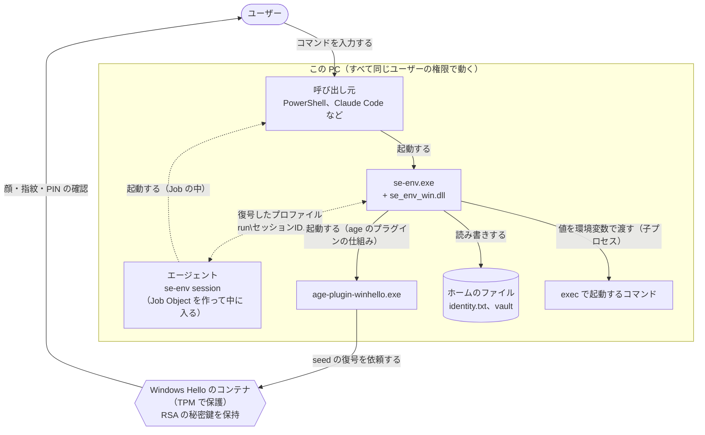

# Windows 版

[English](windows.md) | 日本語

Windows で se-env をビルドしてインストールする手順と、Windows に固有の仕組みを説明します。両方の OS に共通する仕組みは [design.ja.md](design.ja.md) にあります。macOS 版は [macos.ja.md](macos.ja.md) です。

Windows 版では鍵を TPM で保護された **Windows Hello** のコンテナに置き、復号のたびに **Windows Hello**（顔・指紋・PIN）を求めます。コマンドとプロファイルの形式は macOS 版と同じです。保管庫は OS ごとに別々で、macOS で作った保管庫を Windows で開くことはできません。

この文書の「実機で確かめた」は Windows 11（Build 26300、AMD fTPM）での結果です。

## 1. 必要なもの

- Windows 10 / 11（x64）と TPM 2.0
- Windows Hello（PIN、指紋、顔のどれか）を設定したユーザー
- ビルドには git、Go 1.26 以降、Rust（stable、`x86_64-pc-windows-msvc`）と、Visual Studio Build Tools の「C++ によるデスクトップ開発」。winget では次のとおりです。

```powershell
winget install --id Microsoft.VisualStudio.BuildTools --override "--quiet --wait --norestart --add Microsoft.VisualStudio.Workload.VCTools --includeRecommended"
winget install --id Rustlang.Rustup
rustup default stable-x86_64-pc-windows-msvc
```

- テストを実行するなら Git for Windows の `sh`（`C:\Program Files\Git\usr\bin\sh.exe`）。セッションのテストがシェルスクリプトを使います。

## 2. 構成

Windows 版は4つのファイルでできています。

| ファイル | 言語 | ソース | 役割 |
|---|---|---|---|
| `se-env.exe` | Go | `cmd/se-env` | 本体。macOS 版と同じソースから作る |
| `se_env_win.dll` | Rust | `win/se-env-win` | se-env が使う Windows API の呼び出し（ACL、ファイルのロック、プロセスの保護、Job Object、ソケットの相手、メモリの暗号化）。se-env.exe が cgo なしで読み込む |
| `age-plugin-winhello.exe` | Rust | `win/age-plugin-winhello` | Windows Hello の鍵を作り、その鍵での復号を Hello のコンテナに依頼する age のプラグイン |
| `se-env-ui.exe` | Rust | `win/se-env-ui` | ダイアログ（伏せ字の入力、確認、改ざんの警告） |

Rust の3つは、共通のクレート `win/sewin`（Windows API）と `win/winhello-core`（鍵の形式。Windows に依存しない）を使います。



## 3. ビルド

下のコマンドを PowerShell で、リポジトリの一番上のディレクトリから1つずつ実行してください。

```powershell
git clone https://github.com/koukichi-net/se-vault.git
cd se-vault
```

### Rust の部分

```powershell
cd win
cargo build --release --locked
cargo test --release --locked --workspace
cd ..
```

- `--locked`：`Cargo.lock` に書かれたバージョンとハッシュのクレートだけを使う。`Cargo.lock` は書き換えない
- `win/.cargo/config.toml` で、C ランタイムを静的にリンクし、インポートする DLL を System32 だけから読み込む指定（`/DEPENDENTLOADFLAG:0x800`）と、Control Flow Guard を有効にしています（9章、10章）。ビルドしたあと `dumpbin /loadconfig` で `Dependent Load Flag` が `0800` であることを確かめられます
- `cargo test` は、プロセスの保護（ASLR などの緩和ポリシー）が実際に有効になることも確かめます
- `winhello-core` のテストは macOS や Linux でも実行できます（`cargo test -p winhello-core`）

### se-env

```powershell
$env:GOTOOLCHAIN = "local"; $env:GOFLAGS = "-mod=readonly"
go mod download; go mod verify
go vet ./...
$env:SE_ENV_TEST_DLL_DIR = "$PWD\win\target\release"; go test ./...
New-Item -ItemType Directory -Force bin | Out-Null
go build -trimpath -o bin\se-env.exe .\cmd\se-env
```

- `SE_ENV_TEST_DLL_DIR`：テストで使う `se_env_win.dll` の場所。テストは DLL を `%TEMP%` の新しいディレクトリにコピーしてから読み込みます。se-env は、ほかの人が書き込める DLL を拒否するためです（システム以外のドライブでは、Authenticated Users に変更を許していることがよくあります）
- テストはソフトウェアの鍵を使うので、Windows Hello は出ません。本体はこの鍵を受け付けません

## 4. インストール

```powershell
$h = "$env:LOCALAPPDATA\se-env"
New-Item -ItemType Directory -Force "$h\bin" | Out-Null
Copy-Item bin\se-env.exe, win\target\release\se_env_win.dll, win\target\release\age-plugin-winhello.exe, win\target\release\se-env-ui.exe "$h\bin\"
# <ホーム>\bin を PATH に入れる（ユーザーの環境変数）
[Environment]::SetEnvironmentVariable("Path", "$h\bin;" + [Environment]::GetEnvironmentVariable("Path", "User"), "User")
```

新しいターミナルを開いてから、次を実行します。

```powershell
se-env help       # 「ファイル」のパスを確認する
se-env init       # Windows Hello の鍵を作る（最初の1回だけ。Windows Hello の確認が2回出る）
```

- ホームは常に `se-env.exe` の1つ上のディレクトリです。`%LOCALAPPDATA%` の下なら、ACL は最初から自分、SYSTEM、Administrators だけです。ビルドしたディレクトリをそのままホームにはしないでください（8章）。
- `se_env_win.dll` は必ず `se-env.exe` と同じディレクトリに置いてください。
- メッセージの言語は、`SE_ENV_LANG`・`LC_ALL`・`LC_MESSAGES`・`LANG` がなければ、Windows のユーザーのロケールに従います。

## 5. 鍵（Windows Hello）

`se-env init` はプラグインに鍵を作らせます。鍵は CNG の「Microsoft Passport Key Storage Provider」（Windows Hello の鍵の置き場所）に作る RSA 2048 ビットの鍵です。

| 設定 | 値 | 意味 |
|---|---|---|
| `Key Usage` | 復号だけ | 署名には使えない |
| `NgcCacheType` | 1（認証必須） | 使うたびに Hello の確認が出る。この設定は鍵に付いていて、呼び出し側からは外せない |
| `Export Policy` | 0 | 秘密鍵を取り出せない |

- 鍵を作る前に、PC に TPM 2.0 があることを確かめます。作ったあとと使う前には、鍵がハードウェアに置かれていること（`NgcKeyImplType` のハードウェアのフラグ）を確かめ、ソフトウェアの鍵は使いません。
- 鍵を作ったら、すぐに1回、実際に復号できることを確かめます。そのため `init` では Hello の確認が2回出ます。
- 確認の方法は Hello に設定した顔・指紋・PIN です。PIN は常に使えます。PIN の総当たりは TPM が防ぎます。

## 6. 暗号化と復号

RSA で運ぶのは乱数の種（seed）だけで、ファイル鍵は seed から作った鍵で認証付き暗号にかけます。このプロバイダーが復号に使えるパディングが PKCS#1 v1.5 だけだからです。

```
pub     = 鍵の公開部分（BCRYPT_RSAPUBLIC_BLOB）
宛先     age1winhello1… = bech32(2 ‖ pub)

宛先スタンザ "winhello <tag>"（age-plugin-winhello が作る）:
    seed   = ランダムな32バイト
    包み鍵  = HKDF-SHA-256(seed, salt = SHA-256(pub), info = "se-env/winhello/v2/wrap")
    本文    = RSA-PKCS1(pub, seed) ‖ ChaCha20-Poly1305(包み鍵, nonce = 0, ファイル鍵)
    tag    = SHA-256(pub) の先頭4バイト
```

- 暗号化に使うのは公開鍵だけなので、Hello の確認は出ません。
- 復号では、プラグインがスタンザの RSA の部分を Hello のコンテナに渡し、確認のあとで seed を受け取ります。秘密鍵はコンテナから出ません。プラグインが手にするのは seed、se-env が手にするのはファイル鍵だけです。
- seed はファイルごとに違います。漏れても、そのファイルが読めるだけです。
- seed が正しく取り出せたかは、ChaCha20-Poly1305 の検証で確かめます。PKCS#1 v1.5 への既知の攻撃は、復号を何度も試せることが前提です。ここでは1回の復号ごとに Hello の承認が要るので、その攻撃は成り立ちません。
- `tag` があるので、プラグインは自分の鍵宛てでないスタンザでは確認を出しません。

`identity.txt` には鍵の名前と公開鍵の SHA-256 を入れた `AGE-PLUGIN-WINHELLO-1…` の行を1つだけ置きます。プラグインは公開鍵を求めるときも復号するときも、確認を出さずに次のことを確かめます。

- `identity.txt` が示す名前の鍵がこのユーザーの Hello のコンテナにある
- その公開鍵の SHA-256 が `identity.txt` と一致する
- その鍵が今も「取り出せない」「使うたびに認証必須」で、ハードウェアにある

`identity.txt` を書き換えて別の鍵宛てに暗号化させるには、攻撃者は Hello のコンテナに自分の鍵を作る必要があり、それには Hello の確認が出ます。確認なしで使える鍵やソフトウェアの鍵は、上の確認で拒否されます。

`se-env exec` はコマンドを子プロセスとして起動し、終わるのを待って、その終了コードを返します。値はコマンドが終わるまで se-env のメモリに残るので、10章の保護で守ります。

## 7. Windows Hello のダイアログ

プラグインは、se-env が渡した「要求元・対象・操作」の文（[design.ja.md](design.ja.md) の4章）を Hello のダイアログに出します（CNG の `Use Context`）。

- プラグインがこの文を使うのは、親プロセスがプラグインと同じディレクトリの `se-env.exe` のときだけです。実行ファイルの実際のパスと、親が自分より先に起動したことを確かめます。そうでないときは「se-env から起動されていない」という文を出します。
- 文とは別に、Windows が要求元のアプリ名を表示します。se-env からの要求なら `age-plugin-winhello` です。
- 同じユーザーのほかのプログラムもこの鍵で復号を求め、好きな文を出せます（偽の「se-env: get work/TOKEN」がそのまま出ることを実機で確かめました）。ただし、確認そのものは省けません。ダイアログの文だけを信用せず、自分が今その操作をしたかどうかで判断してください。
- 顔認証は、ダイアログが出た瞬間に自動で承認することがあります。心当たりのない要求を見てから拒否したいなら、PIN か指紋を使ってください。

## 8. ファイルと権限

権限は ACL で確かめます。

- se-env は秘密を扱う前に、ホーム、`bin`、`se-env.exe`、プラグイン、`se-env-ui.exe`、`se_env_win.dll`、`identity.txt`、`vault`、`run` を調べます。所有者が自分、SYSTEM、Administrators、TrustedInstaller のどれかで、それ以外の誰にも書き込みの権限がないことを確かめ、そうでなければ動作を止めます。
- `init` は `vault` に、`run` はセッションを始めるときに、継承を切った ACL（自分、SYSTEM、Administrators だけ）を付けます。
- `se_env_win.dll` は、`se-env.exe` と同じディレクトリから絶対パスで読み込みます。ほかの場所は探しません。保護をかけるために起動の直後に読み込むので、上の確認はそのあとになります。`bin` にほかの人が書き込めるなら、`se-env.exe` 自体も差し替えられるので、確認の順番で守れる範囲は変わりません。
- ホームは `%LOCALAPPDATA%\se-env` に置くのを前提にしています。システム以外のドライブは、Authenticated Users に変更を許していることが多いので、ビルドしたディレクトリをそのままホームにはしないでください。

## 9. プログラムの起動と環境変数

Windows では、プログラムが別のプログラムを起動するときに、カレントディレクトリや同じディレクトリを先に探すことがあります。se-env はそれぞれ次のように探す場所を絞っています。

| 起動するもの | 対策 |
|---|---|
| プラグイン | `PATH` をプラグインのディレクトリ1つに絞る。加えて `NoDefaultCurrentDirectoryInExePath` を設定し、カレントディレクトリを探さないようにする。`GODEBUG` は se-env 自身の環境から外す（`execerrdot=0` などで Go の安全確認を外させないため）。どちらも `exec` と `session` のコマンドには元のまま渡す |
| プログラムが読み込む DLL | Rust の3つのプログラムと DLL は、インポートする DLL を System32 だけから読み込む（`/DEPENDENTLOADFLAG:0x800`）。`ncrypt.dll` や `tbs.dll` などを、プログラムと同じディレクトリから読み込まない |
| `exec` と `session` のコマンド | カレントディレクトリと相対パスの `PATH` からは探さない |
| ダイアログ | `se-env.exe` と同じディレクトリの `se-env-ui.exe` だけを使う |

キー名は [design.ja.md](design.ja.md) の3章の一覧に加えて、Windows でプログラムの起動のしかたを変える名前も拒否します。`PATHEXT`、`COMSPEC`、`PSModulePath`、`SystemRoot`、`windir`、`TEMP`、`TMP`、`HOMEDRIVE`、`HOMEPATH`、`ProgramFiles`、`__COMPAT_LAYER`、`PSExecutionPolicyPreference`、`NoDefaultCurrentDirectoryInExePath`、.NET のプロファイラや起動時のフックなどです。Windows の環境変数は大文字と小文字を区別しないので、名前も区別せずに比べます。

## 10. 同じユーザーのほかのプログラムへの備え

Windows では、昇格していないプログラムでも、同じユーザーのプロセスを開いてメモリを読み、ハンドルを複製し、スレッドを乗っ取れます。そこで se-env（すべてのコマンド）、プラグイン、`se-env-ui.exe` は、起動した直後に自分を次のように保護します。

| 保護 | 内容 |
|---|---|
| プロセスの ACL | ほかのプロセスに許すのは、状態の問い合わせ、終了の待機、強制終了だけ。メモリの読み書き、ハンドルの複製、スレッドの作成、親としての利用はできない。所有者が ACL を戻すことも防ぐ |
| スレッドの ACL | 許すのは問い合わせと待機だけ。一時停止やレジスタの読み書きはできない。あとから増えたスレッドにも付くよう、プロセスが動いている間ずっと付け直す（Go のランタイムのスレッドは 50 ミリ秒以内、それ以外は2秒以内） |
| 緩和ポリシー | ASLR の強制、AppInit DLL やウィンドウフックなど古い仕組みでの DLL の読み込みの禁止、ネットワーク上の DLL の禁止、Microsoft の署名がない DLL の禁止、実行可能なメモリを新しく作ることの禁止 |
| Control Flow Guard | Rust の部分は、間接呼び出しの行き先を関数の入口に限る |
| セッションのキャッシュ | エージェントは、復号したプロファイルを `CryptProtectMemory` で暗号化して持ち、要求に応えるときだけ復号する。暗号化できなければキャッシュしない |
| ダンプ | Windows エラー報告のダンプにヒープを入れない |
| 保護に失敗したとき | se-env は保管庫を使うコマンドを実行しない。プラグインは何もせずに終了する。`se-env-ui.exe` は値の入力を受け付けない |

実機で、se-env が動き出したあとに来た、昇格していない同じユーザーのプロセスからは、メモリの読み取り、ハンドルの複製、スレッドの作成とスレッドの乗っ取りが拒否されることを確かめました。

ただし、これは攻撃を難しくするための備えで、**同じユーザーのマルウェアに対する境界ではありません**。実機で次のことを確かめています。

- プロセスを起動してから保護がかかるまでの約 0.1 秒は、ほかのプロセスが全権で開けます。そのとき開いたハンドルは、保護のあとも使えます。
- se-env を起動したプログラム（シェルなど）と、コンソールのホスト（`conhost.exe`）は、se-env への全権のハンドルを持っています。どちらも保護されていない同じユーザーのプロセスなので、そこに入り込めば se-env のメモリを読めます。
- `exec` と `session` で起動する子プロセスはふつうのプロセスです。同じユーザーのプログラムはそのメモリと環境変数を読めます。

## 11. セッションのメンバーの判定

- メンバーは **Job Object** で判定します。エージェントは名前のない Job を作って自分をその中に入れ、それからセッションのコマンドを起動します。Job の中のプロセスが起動したプロセスは、自動的に同じ Job に入ります。Job は抜けることを許可していないので、子孫は Job から出られません。
- エージェントは接続してきた相手の PID をソケットから得て（`SIO_AF_UNIX_GETPEERPID`）、相手が同じユーザーか（トークンのユーザー SID）と、Job の中にいるか（`IsProcessInJob`）を確かめます。PID が使い回されても、Job の中にいるのはセッションの子孫だけなので、問題になりません。
- se-env の側は、待ち受けているのが同じユーザーで自分の祖先であるときだけソケットを使います。親をたどるときは、親の起動時刻が子より後なら PID の使い回しとみなして止まります。

セッションの中でそのまま使えることを、Git for Windows の `sh`、cmd、PowerShell、Node.js、Claude Code で確かめました。子プロセスを `CREATE_BREAKAWAY_FROM_JOB` で起動するプログラムは、セッションの中では起動に失敗します。Windows が別に起動するプログラムは Job に入りません。セッションの中から Windows Terminal の新しいウィンドウを開くと、その中のシェルはセッションの外になります。Windows Terminal ではタブの中で `se-env session` を起動してください。

## 12. 使える場面と、鍵を失う操作

- Hello の確認は PC の前でサインインしているデスクトップにしか出ません。SSH の中では確認の要らない操作（`list`、`ls`、公開鍵を求めること）だけが動きます。リモートデスクトップの中では鍵の作成も復号も `0x80090010`（アクセス拒否）で失敗します。
- Hello の PIN を**変更**しても、鍵は残ります。
- Hello の PIN を**削除**すると鍵は消え、設定し直しても戻りません。TPM を**クリア**すると、鍵は名前だけ残り、使えなくなります。どちらの場合も、保管庫は二度と復号できません。se-env は復号に失敗したとき、確認を出さずにプラグインに鍵の状態を尋ね、鍵が失われていればそう表示します。秘密の値は元の発行元で作り直せるようにしておいてください。

## 13. Windows に固有の限界

[design.ja.md](design.ja.md) の7章に加えて、Windows では次の点があります。

### 守れるもの

- 秘密鍵は Hello のコンテナから出ず、se-env やプラグインのメモリに出ません。同じユーザーのプログラムが se-env のファイルやメモリをすべて読めたとしても、鍵は手に入りません。手に入るのは、そのとき扱っていたファイル鍵と値だけです。
- 鍵が黙って使われることも防げます。鍵を使うたびに Hello の確認が出ます。この確認は鍵の設定で強制され、se-env 以外のプログラムが呼び出しても省けません。

### 守れないもの

- 同じユーザーのマルウェアに対しては、10章と11章のとおり、プロセスの保護もセッションも境界になりません。保護をかける前に開いたハンドル、シェルや `conhost.exe` が持つハンドル、セッションのプロセスへの入り込みを通して、値を読まれることがあります。セッションのコマンドに入り込むか、そのプロセスを親に指定して自分を起動したプログラムは、メンバーとして扱われ、Hello なしでキャッシュ済みのプロファイルを受け取れます。`--only` と `--ttl` を絞ることが、被害の範囲を決めます。
- マルウェアは自分で復号を求め、好きな文のダイアログを出して、あなたが承認するのを待ったり、承認するよう誘導したりできます。
- 管理者として昇格し、`SeDebugPrivilege` を持つプログラムは、10章の保護をすべて越えられます。
- `se-env set` で値を入力するときのキー入力は、同じユーザーのキーロガーから守れません。
- 12章のとおり、SSH とリモートデスクトップでは使えず、PIN の削除や TPM のクリアで保管庫を失います。

## 14. ビルドの完全性

Go の部分は `go mod verify` で照合し、`GOTOOLCHAIN=local` と `GOFLAGS=-mod=readonly` でビルドします。Rust の部分は `cargo build --locked` で、`Cargo.lock` に固定したバージョンとハッシュのクレートだけを使います。C ランタイムは静的にリンクします（起動後は Microsoft の署名がある DLL しか読み込めないため）。DLL を System32 から読み込む指定と Control Flow Guard は `win/.cargo/config.toml` で有効にしていて、`dumpbin /loadconfig` で確かめられます。

## 15. 更新するとき

- Rust のクレート：`cargo update -p <クレート>` で `Cargo.lock` が変わります。変更内容（特に `age-core`、`age-plugin`、`windows`、`windows-sys`）を確かめてからビルドし直してください。
- `win/se-env-win` の関数を変えたら、`ABI_VERSION` と `cmd/se-env/win_windows.go` の `dllABI` を一緒に上げてください。食い違うと se-env は DLL を使いません。

ビルドし直して置き換わるのはプログラムだけで、鍵や保管庫には影響しません。Windows Hello の鍵は Windows のユーザーの中にあり、`identity.txt` はその名前と公開鍵を指しています。
