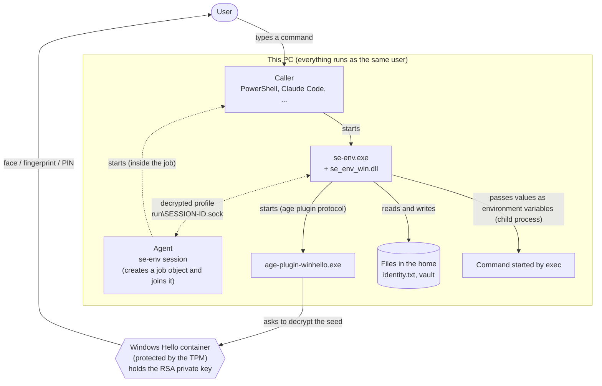

# Windows

English | [日本語](windows.ja.md)

How to build and install se-env on Windows, and what is specific to Windows. What both OSes share is in [design.md](design.md). The macOS version is in [macos.md](macos.md).

On Windows the key lives in the TPM-backed **Windows Hello** container, and every decryption asks for **Windows Hello** (face, fingerprint or PIN). The commands and the profile format are the same as on macOS. Each OS has its own vault; a vault made on macOS cannot be opened on Windows.

"Tested on a real machine" in this document means Windows 11 (Build 26300, AMD fTPM).

## 1. Requirements

- Windows 10 / 11 (x64) with TPM 2.0
- a user with Windows Hello set up (PIN, fingerprint or face)
- To build: git, Go 1.26 or later, Rust (stable, `x86_64-pc-windows-msvc`) and the Visual Studio Build Tools "Desktop development with C++". With winget:

```powershell
winget install --id Microsoft.VisualStudio.BuildTools --override "--quiet --wait --norestart --add Microsoft.VisualStudio.Workload.VCTools --includeRecommended"
winget install --id Rustlang.Rustup
rustup default stable-x86_64-pc-windows-msvc
```

- for the tests, `sh` from Git for Windows (`C:\Program Files\Git\usr\bin\sh.exe`): the session tests use shell scripts.

## 2. Components

The Windows version consists of four files:

| File | Language | Source | Role |
|---|---|---|---|
| `se-env.exe` | Go | `cmd/se-env` | the tool, built from the same source as on macOS |
| `se_env_win.dll` | Rust | `win/se-env-win` | the Windows API calls se-env needs (ACLs, file locks, process hardening, job objects, socket peers, memory encryption). se-env.exe loads it without cgo |
| `age-plugin-winhello.exe` | Rust | `win/age-plugin-winhello` | the age plugin that creates the Windows Hello key and asks the Hello container to decrypt with it |
| `se-env-ui.exe` | Rust | `win/se-env-ui` | the dialogs (hidden input, confirmation, the tampering alert) |

The three Rust programs share the crates `win/sewin` (Windows API) and `win/winhello-core` (key formats; no Windows dependency).



## 3. Build

Run the commands below in PowerShell, one at a time, from the top directory of the repository.

```powershell
git clone https://github.com/koukichi-net/se-vault.git
cd se-vault
```

### The Rust parts

```powershell
cd win
cargo build --release --locked
cargo test --release --locked --workspace
cd ..
```

- `--locked`: use only the crate versions and hashes in `Cargo.lock`, and never rewrite it
- `win/.cargo/config.toml` links the C runtime statically, makes the programs load the DLLs they import from System32 only (`/DEPENDENTLOADFLAG:0x800`), and turns Control Flow Guard on (§9, §10). After a build, `dumpbin /loadconfig` shows `0800` as the `Dependent Load Flag`
- `cargo test` also checks that the process hardening (ASLR and the other mitigation policies) really takes effect
- The `winhello-core` tests also run on macOS and Linux (`cargo test -p winhello-core`)

### se-env

```powershell
$env:GOTOOLCHAIN = "local"; $env:GOFLAGS = "-mod=readonly"
go mod download; go mod verify
go vet ./...
$env:SE_ENV_TEST_DLL_DIR = "$PWD\win\target\release"; go test ./...
New-Item -ItemType Directory -Force bin | Out-Null
go build -trimpath -o bin\se-env.exe .\cmd\se-env
```

- `SE_ENV_TEST_DLL_DIR`: where the tests find `se_env_win.dll`. They copy it to a new directory in `%TEMP%` first, because se-env refuses a DLL that others may write to (non-system drives often let Authenticated Users modify).
- The tests use software keys, so no Windows Hello prompt appears. The program itself refuses such keys.

## 4. Install

```powershell
$h = "$env:LOCALAPPDATA\se-env"
New-Item -ItemType Directory -Force "$h\bin" | Out-Null
Copy-Item bin\se-env.exe, win\target\release\se_env_win.dll, win\target\release\age-plugin-winhello.exe, win\target\release\se-env-ui.exe "$h\bin\"
# put <home>\bin on PATH (user environment)
[Environment]::SetEnvironmentVariable("Path", "$h\bin;" + [Environment]::GetEnvironmentVariable("Path", "User"), "User")
```

Then, in a new terminal:

```powershell
se-env help       # check the paths under "Files"
se-env init       # create the Windows Hello key (once; Windows Hello asks twice)
```

- The home is always the directory above `se-env.exe`. Under `%LOCALAPPDATA%` its ACL already allows only you, SYSTEM and Administrators. Do not use the build directory as the home (§8).
- Keep `se_env_win.dll` in the same directory as `se-env.exe`.
- Messages follow `SE_ENV_LANG`, `LC_ALL`, `LC_MESSAGES` or `LANG`; without them, the Windows user locale.

## 5. The key (Windows Hello)

`se-env init` has the plugin create the key: an RSA 2048-bit key in CNG's "Microsoft Passport Key Storage Provider" (where Windows Hello keeps its keys).

| Setting | Value | Meaning |
|---|---|---|
| `Key Usage` | decrypt only | it cannot sign |
| `NgcCacheType` | 1 (authentication mandatory) | every use asks for Hello. The setting belongs to the key; a caller cannot turn it off |
| `Export Policy` | 0 | the private key cannot be exported |

- Before creating the key, the plugin checks that the PC has a TPM 2.0. After creating it and before every use, it checks that the key is kept in hardware (the hardware flag of `NgcKeyImplType`) and refuses a software key.
- Right after creating the key, it decrypts once to prove that the key works. That is why `init` asks for Hello twice.
- You confirm with the face, fingerprint or PIN set up in Hello. The PIN is always available; the TPM stops anyone from guessing it.

## 6. Encryption and decryption

RSA carries only a random seed, and the file key is sealed with authenticated encryption under a key derived from the seed, because this provider decrypts with PKCS#1 v1.5 padding only.

```
pub     = the public part of the key (BCRYPT_RSAPUBLIC_BLOB)
recipient age1winhello1… = bech32(2 ‖ pub)

recipient stanza "winhello <tag>" (written by age-plugin-winhello):
    seed     = 32 random bytes
    wrap key = HKDF-SHA-256(seed, salt = SHA-256(pub), info = "se-env/winhello/v2/wrap")
    body     = RSA-PKCS1(pub, seed) ‖ ChaCha20-Poly1305(wrap key, nonce = 0, file key)
    tag      = first 4 bytes of SHA-256(pub)
```

- Encryption uses the public key only, so it asks for nothing.
- To decrypt, the plugin hands the RSA part of the stanza to the Hello container and gets the seed back after you approve. The private key never leaves the container. The plugin only ever holds the seed, and se-env the file key.
- The seed differs from file to file. A leaked seed opens that one file.
- ChaCha20-Poly1305 checks that the seed came out right. The known attacks on PKCS#1 v1.5 need many decryption attempts; here every decryption needs a Hello approval, so they do not apply.
- Thanks to the `tag`, the plugin shows no prompt for a stanza that is not for its key.

`identity.txt` holds a single `AGE-PLUGIN-WINHELLO-1…` line with the key's name and the SHA-256 of its public key. Whenever the plugin derives the public key or decrypts, it checks, without asking for anything:

- a key of the name `identity.txt` gives exists in this user's Hello container
- the SHA-256 of its public key matches `identity.txt`
- the key is still not exportable, still needs Hello for every use, and is kept in hardware

To make se-env encrypt to another key by editing `identity.txt`, an attacker would have to create their own key in the Hello container, which asks for Hello. Keys usable without a prompt and software keys fail the checks above.

`se-env exec` starts the command as a child process, waits for it and returns its exit code. The values stay in se-env's memory until the command ends, under the protection of §10.

## 7. The Windows Hello dialog

The plugin shows the "who asks, for what, to do what" text that se-env passes ([design.md](design.md) §4) in the Hello dialog (CNG's `Use Context`).

- The plugin uses the text only when its parent is the `se-env.exe` in the plugin's own directory. It compares the real path of the executable and checks that the parent started before the plugin. Otherwise it says the request did not come from se-env.
- Besides the text, Windows shows the name of the requesting app. For a request from se-env that is `age-plugin-winhello`.
- Other programs of the same user can also ask this key to decrypt and show any text they like (a fake "se-env: get work/TOKEN" was shown verbatim on a real machine). They cannot skip the prompt itself. Do not trust the text of the dialog alone: judge by whether you just did that.
- Face recognition may approve the moment the dialog appears. If you want to read a request before you refuse it, use a PIN or a fingerprint.

## 8. Files and permissions

Permissions are checked through ACLs.

- Before it handles a secret, se-env looks at the home, `bin`, `se-env.exe`, the plugin, `se-env-ui.exe`, `se_env_win.dll`, `identity.txt`, `vault` and `run`. Each must be owned by you, SYSTEM, Administrators or TrustedInstaller, and nobody else may write to it; otherwise se-env stops.
- `init` gives `vault`, and starting a session gives `run`, a protected ACL (you, SYSTEM and Administrators only).
- `se_env_win.dll` is loaded by absolute path from the directory of `se-env.exe`, and from nowhere else. It is loaded right after start, to harden the process, so the check above comes after it. If others could write to `bin`, they could replace `se-env.exe` itself, so the order does not change what is protected.
- The home is meant to be `%LOCALAPPDATA%\se-env`. Drives other than the system drive often let Authenticated Users modify files, so do not use the build directory as the home.

## 9. Starting programs and the environment

When a Windows program starts another, Windows may look in the current directory or the program's own directory first. se-env narrows where each of these is looked for:

| What is started | What se-env does |
|---|---|
| The plugin | `PATH` is narrowed to the plugin's directory. In addition, `NoDefaultCurrentDirectoryInExePath` is set so the current directory is not searched, and `GODEBUG` is removed from se-env's own environment (so that `execerrdot=0` and the like cannot switch off Go's safety checks). Commands started by `exec` and `session` get both as the caller had them |
| DLLs the programs import | The three Rust programs and the DLL load their imported DLLs from System32 only (`/DEPENDENTLOADFLAG:0x800`). `ncrypt.dll`, `tbs.dll` and others are never loaded from the program's directory |
| Commands of `exec` and `session` | Never looked for in the current directory or in relative `PATH` entries |
| Dialogs | Only the `se-env-ui.exe` next to `se-env.exe` |

Besides the names in §3 of [design.md](design.md), key names that change how programs start on Windows are refused: `PATHEXT`, `COMSPEC`, `PSModulePath`, `SystemRoot`, `windir`, `TEMP`, `TMP`, `HOMEDRIVE`, `HOMEPATH`, `ProgramFiles`, `__COMPAT_LAYER`, `PSExecutionPolicyPreference`, `NoDefaultCurrentDirectoryInExePath`, the .NET profiler and startup hook variables, and more. Windows variable names are case-insensitive, and so is the comparison.

## 10. Against other programs of the same user

On Windows, an unelevated program can open a process of the same user, read its memory, duplicate its handles and hijack its threads. So se-env (every command), the plugin and `se-env-ui.exe` protect themselves right after they start:

| Protection | What it does |
|---|---|
| Process ACL | Other processes may only query the process, wait for it and terminate it. They cannot read or write its memory, duplicate its handles, create threads in it, or use it as a parent. The owner cannot restore the ACL either |
| Thread ACLs | Only query and wait. No suspending, no reading or setting registers. Re-applied for as long as the process runs, so new threads get them too (Go runtime threads within 50 ms, others within 2 seconds) |
| Mitigation policies | Forced ASLR; no DLLs through AppInit, window hooks and other legacy ways; no DLLs from network shares; no DLLs without a Microsoft signature; no new executable memory |
| Control Flow Guard | In the Rust parts, indirect calls may only go to function entries |
| Session cache | The agent keeps decrypted profiles encrypted with `CryptProtectMemory` and decrypts one only to answer a request. What it cannot encrypt, it does not cache |
| Dumps | Windows Error Reporting dumps leave out the heap |
| If hardening fails | se-env runs no command that touches the vault, the plugin exits without doing anything, and `se-env-ui.exe` does not take a value |

On a real machine, unelevated processes of the same user that came after se-env had started were refused reading memory, duplicating handles, creating threads and taking over threads.

This makes attacks harder; **it is not a boundary against malware running as the same user**. The tests showed:

- For about 0.1 seconds after a process starts, until the protection is in place, other processes can open it with full access. A handle opened then stays usable afterwards.
- The program that started se-env (a shell, for example) and the console host (`conhost.exe`) hold full-access handles to se-env. Both are unprotected processes of the same user; whatever gets into them can read se-env's memory.
- Child processes started by `exec` and `session` are ordinary processes. Programs of the same user can read their memory and environment.

## 11. Recognising session members

- Members are recognised by a **job object**. The agent creates an unnamed job, puts itself in it, and then starts the session's command. Processes started by a process in the job are in the job too. The job does not allow breakaway, so descendants cannot leave it.
- The agent gets the PID of the connecting process from the socket (`SIO_AF_UNIX_GETPEERPID`) and checks that it runs as the same user (the user SID of its token) and that it is in the job (`IsProcessInJob`). A reused PID does not matter: only descendants of the session are in the job.
- se-env in turn uses a socket only when the listening process runs as the same user and is its own ancestor. While walking up the parents, a parent that started after its child is taken for a reused PID and the walk stops.

Git for Windows' `sh`, cmd, PowerShell, Node.js and Claude Code work inside a session as they are. A program that starts children with `CREATE_BREAKAWAY_FROM_JOB` fails to start them inside a session. Programs that Windows starts on its own are not in the job: a new Windows Terminal window opened from inside a session runs its shells outside it. With Windows Terminal, start `se-env session` inside a tab.

## 12. Where it works, and what loses the key

- Hello prompts appear only on the desktop of the user signed in at the PC itself. In SSH, only what needs no prompt works (`list`, `ls`, deriving the public key). In Remote Desktop, creating a key and decrypting both fail with `0x80090010` (access denied).
- **Changing** the Hello PIN keeps the key.
- **Removing** the Hello PIN deletes the key, and setting a PIN again does not bring it back. **Clearing** the TPM leaves only the key's name; the key can no longer be used. Either way the vault can never be decrypted again. When decryption fails, se-env asks the plugin about the key without a prompt and says so if the key is gone. Make sure your secrets can be issued again by whoever issued them.

## 13. Limits specific to Windows

In addition to [design.md](design.md) §7:

### Protected

- The private key never leaves the Hello container and never appears in the memory of se-env or the plugin. Even a program of the same user that can read all of se-env's files and memory does not get the key; it gets only the file keys and values being handled at that moment.
- The key cannot be used silently either. Every use asks for Hello. The prompt is enforced by the key's settings, and programs other than se-env cannot skip it.

### Not protected

- Against malware running as the same user, neither the process protection nor sessions are a boundary (§10 and §11). Values can be read through handles opened before the protection is in place, through the handles that shells and `conhost.exe` hold, and by getting into a process of the session. A program that gets into one of the session's commands, or starts itself with one of them as its parent, is treated as a member and receives cached profiles without Hello. Keeping `--only` and `--ttl` narrow is what limits the damage.
- Malware can ask to decrypt on its own, show a dialog with any text, and wait for you to approve or lead you into approving.
- A program elevated as administrator with `SeDebugPrivilege` can get past all the protections of §10.
- Keystrokes while you type a value into `se-env set` are not protected from a keylogger running as the same user.
- As in §12, se-env does not work in SSH or Remote Desktop, and removing the PIN or clearing the TPM loses the vault.

## 14. Build integrity

The Go part is checked with `go mod verify` and built with `GOTOOLCHAIN=local` and `GOFLAGS=-mod=readonly`. The Rust part is built with `cargo build --locked`, which uses only the crate versions and hashes pinned in `Cargo.lock`. The C runtime is linked statically, because after start the programs can load only DLLs signed by Microsoft. Loading DLLs from System32 and Control Flow Guard are turned on in `win/.cargo/config.toml`, and `dumpbin /loadconfig` shows them.

## 15. Updating

- Rust crates: `cargo update -p <crate>` changes `Cargo.lock`. Review the changes (especially `age-core`, `age-plugin`, `windows`, `windows-sys`) before rebuilding.
- When a function of `win/se-env-win` changes, raise `ABI_VERSION` there and `dllABI` in `cmd/se-env/win_windows.go` together; se-env does not use a DLL whose version differs.

Rebuilding replaces only the programs, never the key or the vault. The Windows Hello key lives in your Windows user; `identity.txt` refers to its name and public key.
